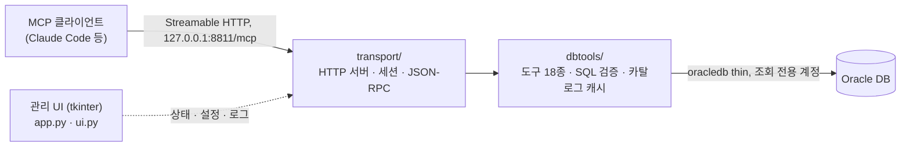

<!-- TODO: 관리 UI 스크린샷 또는 데모 GIF를 만들면 assets/ 에 두고 히어로 아래에 삽입 -->

<h1 align="center">DBridge</h1>

<p align="center">
  <a href="README.md">English</a> · <b>한국어</b>
</p>

<p align="center">
  <strong>폐쇄망을 전제로 만든 Oracle 조회 전용 MCP 프록시</strong>
  <br/>
  <sub>Claude Code 같은 AI 에이전트가 PC 안의 로컬 프록시를 거쳐 Oracle DB를 탐색·조회합니다. 프록시는 <code>127.0.0.1</code>에만 열리고, 사용자 SQL은 단일 <code>SELECT</code>/<code>WITH</code>만 다룹니다.</sub>
</p>

<p align="center">
  
  
  
  
  
  <a href="LICENSE"></a>
</p>

<p align="center">
  <a href="#왜-dbridge인가">왜</a> ·
  <a href="#빠른-시작">빠른 시작</a> ·
  <a href="#폐쇄망-배포">폐쇄망 배포</a> ·
  <a href="#도구-18종">도구</a> ·
  <a href="#안전-장치">안전 장치</a> ·
  <a href="#관리-ui">관리 UI</a> ·
  <a href="#설정">설정</a> ·
  <a href="#개발">개발</a> ·
  <a href="#보안과-한계">보안과 한계</a> ·
  <a href="#기여하기">기여</a>
</p>

인터넷이 막힌 폐쇄망에서 AI 에이전트에게 DB 조회를 맡기려면, 외부 서비스 없이 PC 안에서 돌고, 쓰기를 막고, 비밀번호를 에이전트에게 넘기지 않는 연결 지점이 필요합니다. DBridge는 이 조건을 전제로 만든 상주형 MCP 서버입니다. 프록시 자체는 인터넷이 필요 없습니다. 다만 에이전트가 쓰는 LLM은 MCP 클라이언트가 연결하므로, 인터넷이 없는 망에서는 망 안에서 닿을 수 있는 LLM 엔드포인트가 따로 있어야 합니다.

- **연결 방식**: PC에 상주하며 `http://127.0.0.1:8811/mcp`로 [MCP](https://modelcontextprotocol.io/) Streamable HTTP 엔드포인트를 엽니다. Claude Code에는 주소 한 줄로 등록합니다. 바인딩 주소는 `127.0.0.1`만 허용하도록 코드에서 강제합니다.
- **읽기 전용**: 에이전트가 보내는 SQL은 프록시의 SQL 검증 계층을 통과한 단일 `SELECT`/`WITH` 문장만 실행합니다. 결과 행 수와 실행 시간에는 상한이 있습니다.
- **에이전트용 도구 18종**: 스키마 요약, 키워드 검색, 테이블 구조, 파티션, 실행 계획, 컬럼 프로파일, 조인 후보처럼 "SQL을 쓰기 전에 알아야 할 것"을 작은 응답으로 돌려줍니다. 테이블이 수천 개인 DB에서도 전체를 나열하지 않고 좁혀 들어가도록 설계했습니다.
- **설치**: 트랜스포트, 도구, 관리 UI(tkinter), 테스트는 Python 표준 라이브러리만 씁니다. 실제 Oracle 접속에만 `oracledb`(thin 모드, Oracle Client 불필요)가 필요하고, Windows 기준 의존성을 포함해 휠 5개(약 6MB)만 반입하면 됩니다.
- **운영**: Windows용 관리 UI에서 서버 상태, 커넥션 헬스, Claude 연동 스니펫, 도구 시험 실행, 설정 편집, 로그를 봅니다. PyInstaller로 exe 하나로 묶어 배포할 수 있습니다.

> 실제 업무에서 운영 중인 제품이며, 현재 beta입니다. 도구 구성과 설정 키는 바뀔 수 있습니다. SQL 검증 계층은 DB 계정 권한을 대체하지 않으므로, 반드시 읽기 전용 계정으로 연결하세요.

<!-- TODO: 운영 검증한 Oracle Database 버전 범위 명시 (thin 모드 하한은 12.1) -->

---

## 왜 DBridge인가

| 폐쇄망의 제약 | 흔히 막히는 지점 | DBridge의 방식 |
| :--- | :--- | :--- |
| 외부 SaaS 사용 불가 | 클라우드 DB 커넥터, 호스팅 MCP 서버는 쓸 수 없음 | PC에서만 실행되는 로컬 프로세스. 프록시가 여는 외부 연결은 설정한 Oracle DSN뿐(LLM 연결은 MCP 클라이언트 몫) |
| pip 설치 제한 | 의존성이 많은 MCP 서버·ORM이나 별도 CLI 배포본은 반입 부담이 큼 | 표준 라이브러리 위주. 반입할 패키지는 `oracledb`와 그 의존성뿐 |
| 쓰기 사고 위험 | SQL을 그대로 실행하는 도구는 계정 권한이 넓으면 쓰기까지 실행함 | 단일 `SELECT`/`WITH`만 통과시키는 SQL 검증 계층, 카탈로그에 있는 식별자만 허용(`query`), 서버 측 행 수 상한, 쿼리 타임아웃. 읽기 전용 계정과 함께 쓰는 것이 전제 |
| 토큰 낭비 | 테이블 목록·결과를 통째로 받아 컨텍스트가 넘침 | 개수 요약부터 보여 주고 키워드·owner·limit으로 좁혀 들어가는 도구 설계. 잘리면 `truncated: true`로 알림 |
| 스키마 수천 개 탐색 | 에이전트가 테이블명을 추측해 SQL을 던짐 | 카탈로그 캐시 기반 통합 검색(테이블·컬럼 이름과 코멘트), 시노님 해석, 조인 후보 제안. 서버가 "추측하지 말고 도구로 확인하라"는 지침을 MCP `instructions`로 전달 |
| 비밀번호 노출 | 접속 정보가 에이전트 설정이나 대화에 들어감 | 비밀번호는 프록시 설정에만 둠(`password_env` 권장). 에이전트에게는 커넥션 이름·DSN·접속 계정명까지만 보이고 비밀번호는 어떤 도구로도 나가지 않음. 로그·오류·상태 표시는 `***`로 가림 |
| DBA 승인 | 에이전트 도구가 DBA 권한이나 딕셔너리 롤을 요구하면 승인이 어려움 | `CREATE SESSION`과 대상 객체 `READ`만으로 동작. `ALL_*` 뷰만 읽고 `DBA_*`·`V$`·`DBMS_SQL`은 쓰지 않음. 타임아웃 시 서버 측 실행 취소 |
| 접근통제 정책 | 조직의 DB 접근통제 환경을 우회하는 경로가 되면 안 됨 | 프록시는 `127.0.0.1`에만 바인딩. 선택적으로 DB 접근통제 에이전트 등 지정 프로그램이 실행 중일 때만 기동(`require_process`, 기동 시 1회 프로세스 이름 확인) |

---

## 빠른 시작

**Windows: 릴리스 빌드 설치.** [Releases](https://github.com/SunnyJLab/DBridge/releases/latest)에서 아래 중 하나를 받습니다. Python과 Oracle Instant Client는 번들에 들어 있거나 필요 없으므로 대상 PC에 따로 설치하지 않습니다. 폐쇄망 PC에는 파일을 그대로 반입하면 됩니다.

| 파일 | 용도 |
| :--- | :--- |
| `DBridge-<버전>-win-x64-setup.exe` | 설치 파일. 관리자 권한 없이 사용자별로 `%LOCALAPPDATA%\Programs\DBridge`에 설치하고, 시작 메뉴 항목과 제거 프로그램을 등록 |
| `DBridge-<버전>-win-x64-portable.zip` | 설치 과정 없는 같은 빌드. 쓰기 가능한 폴더에 풀고 `DBridge.exe` 실행 |

첫 실행 때 `DBridge.exe` 옆에 `config.json`이 생깁니다. 여기(형식은 아래 2단계)나 관리 UI에서 접속 정보를 채운 뒤 4단계 Claude Code에 연결부터 이어서 진행하세요. 받은 파일은 릴리스의 `SHA256SUMS.txt`로 확인할 수 있습니다. 코드 서명이 없어 첫 실행 때 Windows SmartScreen 경고가 뜰 수 있습니다.

아래는 소스에서 바로 실행하는 순서입니다. 소스를 폐쇄망 PC에 반입·배포하는 방법은 [폐쇄망 배포](#폐쇄망-배포)를 보세요.

필요한 것

- Python 3.11 (운영 기준 버전. tkinter 포함 배포판). 최신 `oracledb`는 Python 3.10 이상을 요구합니다. <!-- TODO: 지원 버전 범위 확정. 3.13에서도 단위 테스트 통과 확인 -->
- 접속할 Oracle DB(12.1 이상)와 **읽기 전용 계정**. thin 모드라 DB가 Native Network Encryption(NNE)을 필수로 요구하면 접속할 수 없습니다(`DPY-3001`). 이 경우 TLS 연결로 바꾸는 방안을 DBA와 협의하세요.
- 관리 UI에는 tkinter가 필요합니다. Windows 공식 설치 파일에는 기본 포함이고, embeddable zip 배포판에는 없습니다. tkinter가 없어도 헤드리스 모드는 동작합니다.
- Claude Code 또는 Streamable HTTP를 지원하는 다른 MCP 클라이언트

대상 운영 환경은 Windows x64입니다. 개발과 테스트는 macOS·Linux에서도 할 수 있습니다.

**1. 가상환경과 의존성**

Windows (PowerShell):

```powershell
git clone https://github.com/SunnyJLab/DBridge.git
cd DBridge
python -m venv .venv
.venv\Scripts\pip install -r requirements.txt
```

macOS / Linux:

```sh
git clone https://github.com/SunnyJLab/DBridge.git
cd DBridge
python3 -m venv .venv
.venv/bin/pip install -r requirements.txt
```

`oracledb`는 thin 모드로 동작하므로 Oracle Instant Client 설치는 필요 없습니다. thin 모드가 쓰는 `cryptography`는 `oracledb`의 의존성으로 함께 설치됩니다.

**2. config.json 작성**

레포 루트(`app.py` 옆)에 `config.json`을 만듭니다. 파일이 없으면 첫 실행 때 기본값으로 생성됩니다. 첫 실행 기본값에는 실행 조건 게이트가 들어 있지 않습니다. 게이트를 쓰려면 `require_process`에 프로세스 이름을 넣으세요. `config.json`은 `.gitignore`에 들어 있어 커밋되지 않습니다.

```json
{
  "proxy": { "host": "127.0.0.1", "port": 8811, "log_level": "INFO" },
  "connections": [
    {
      "name": "dw",
      "dsn": "db.example.internal:1521/ORCL",
      "user": "readonly_user",
      "password_env": "MCP_DB_PW",
      "pool_max": 5
    }
  ],
  "require_process": []
}
```

비밀번호는 `password_env`에 적은 환경변수에서 읽습니다.

```powershell
$env:MCP_DB_PW = "your-password"     # Windows (PowerShell, 현재 창에서만)
[Environment]::SetEnvironmentVariable("MCP_DB_PW", "your-password", "User")   # 사용자 환경변수로 영구 저장
```

```sh
export MCP_DB_PW='your-password'     # macOS / Linux
```

`"require_process": []`이거나 이 키를 **생략하면** 실행 조건 게이트는 비활성입니다. 기본 감시 대상은 없습니다. 게이트를 쓰려면 프로세스 이름을 지정하세요. 자세한 내용은 [실행 조건 게이트](#4-실행-조건-게이트-require_process)를 보세요.

`[Environment]::SetEnvironmentVariable`로 저장한 값은 그 뒤에 새로 연 창과 탐색기에서 실행한 프로그램부터 보입니다. 관리 UI나 exe를 탐색기에서 띄운다면 이 방법을 쓰세요.

**3. 실행**

```sh
# 관리 UI + MCP 서버 (기본: app.py 옆 config.json)
.venv/bin/python app.py                      # Windows: .venv\Scripts\python app.py
.venv/bin/python app.py --config path/to/config.json

# UI 없이 MCP 서버만 (헤드리스)
.venv/bin/python -m transport --config config.json
```

관리 UI가 뜨고 사이드바 하단에 실행 상태가 표시됩니다. 서버는 기동 직후 각 커넥션의 카탈로그(테이블·컬럼·코멘트 등 메타데이터)를 백그라운드로 수집합니다. DB가 크면 수십 초 걸릴 수 있고, 그동안에도 UI와 MCP 엔드포인트는 응답합니다. 커넥션이 실패하면 상태 페이지의 커넥션 행이 `실패`로 바뀝니다. ORA 오류 코드가 있으면 함께 표시되고, 환경변수 누락처럼 코드가 없는 원인은 **로그** 페이지에 남습니다.

헤드리스 모드는 로그를 표준 오류로만 출력하고 `logs/` 파일을 만들지 않으며, `config.json`이 없을 때 기본값을 생성하지도 않습니다. Ctrl+C로 종료합니다.

**4. Claude Code에 연결**

CLI 한 줄:

```sh
claude mcp add --transport http dbridge http://127.0.0.1:8811/mcp
```

또는 프로젝트 루트의 `.mcp.json`:

```json
{
  "mcpServers": {
    "dbridge": {
      "type": "http",
      "url": "http://127.0.0.1:8811/mcp"
    }
  }
}
```

두 스니펫은 관리 UI의 **Claude 연동** 페이지에서 현재 포트에 맞춰 생성되고 복사 버튼으로 가져갈 수 있습니다. 서버 이름은 `dbridge`이고, 창 제목은 DBridge입니다. 프록시가 실행 중일 때만 연결됩니다.

Claude Code 외의 MCP 클라이언트도 Streamable HTTP 트랜스포트를 지원하면 같은 주소로 연결할 수 있습니다. 서버가 지원하는 MCP 프로토콜 버전은 `2025-03-26`입니다. <!-- TODO: Claude Code 외 클라이언트 실측 결과(이름·버전·동작 여부) 표 추가 -->

연결되면 에이전트에게 이렇게 요청해 보세요.

- "dw 커넥션에 어떤 스키마가 있는지 개수만 보여줘"
- "'매출' 관련 테이블 찾아서 컬럼 구조 알려줘"
- "이 테이블 최근 파티션 3개 행수 보여주고, 파티션 키로 걸러서 지난달 합계 내줘"

<details>
<summary><b>처음 실행이 막힐 때</b></summary>

| 증상 | 원인과 조치 |
| :--- | :--- |
| "필수 프로그램이 실행 중이 아닙니다" 창 후 종료 | `require_process`에 적은 프로세스가 실행 중이 아닙니다. 게이트를 끄려면 키를 빼거나 `[]`로 고치세요 |
| `ModuleNotFoundError: No module named 'tkinter'` | tkinter 없는 Python입니다. tkinter 포함 배포판을 쓰거나 헤드리스(`python -m transport`)로 실행하세요 |
| 커넥션이 `실패`, 연결 테스트가 "DB 드라이버를 사용할 수 없습니다" | `oracledb` 미설치이거나 `password_env` 환경변수가 이 프로세스에 보이지 않는 경우입니다. 로그 페이지에서 원인을 확인하세요 |
| `DPY-3001` | DB가 Native Network Encryption을 요구합니다. thin 모드는 지원하지 않습니다 |
| `DPY-3010` / `DPY-3015` | Oracle 11.2 이하 DB이거나 10G password verifier만 있는 계정입니다 |
| 서버가 중지 상태로 뜨고 로그에 포트 점유 오류 | `proxy.port`를 바꾸고 MCP 클라이언트에 등록한 주소도 바꾸세요 |
| 헤드리스에서 `FileNotFoundError` | 헤드리스는 `config.json`을 생성하지 않습니다. 먼저 파일을 만드세요 |

</details>

---

## 폐쇄망 배포

### 1. 오프라인 휠 반입

트랜스포트·도구·UI는 표준 라이브러리만 쓰므로, 반입할 패키지는 `oracledb`와 그 의존성뿐입니다. `oracledb`와 `cryptography`는 **네이티브 확장이 들어 있는 휠**이라, 인터넷 PC에서 받을 때 대상 PC의 플랫폼과 Python 버전을 반드시 지정해야 합니다.

```powershell
# 1) 인터넷 PC: 대상 환경을 지정해 휠을 내려받는다 (예: Windows x64, Python 3.11)
python -m pip download oracledb -d wheels --only-binary=:all: --platform win_amd64 --python-version 3.11

# 2) 소스 폴더와 wheels 폴더를 반입한 뒤, 폐쇄망 PC에서
python -m venv .venv
.venv\Scripts\pip install --no-index --find-links wheels -r requirements.txt
```

반입 목록 (Windows x64, Python 3.11 기준 실측)

| 파일 | 크기 | 비고 |
| :--- | ---: | :--- |
| 소스 (`*.py`, `theme_sv/`) | 약 0.9MB | `theme_sv/`는 `sun` 팔레트를 쓸 때만 필요 |
| `oracledb-*-cp311-win_amd64.whl` | 약 2.1MB | thin 모드 드라이버 |
| `cryptography-*-win_amd64.whl` | 약 3.8MB | `oracledb`의 의존성 |
| `cffi`, `pycparser`, `typing_extensions` | 약 0.3MB | 의존성 |

- 대상 PC의 Python 버전과 `--python-version`이 다르면 설치 단계에서 휠을 찾지 못합니다. 반입 전 `wheels` 폴더의 파일명(`cp311`, `win_amd64` 등)을 확인하세요.
- 버전과 크기는 받는 시점에 따라 달라집니다. 최신 `oracledb`는 Python 3.10 이상을 요구합니다.
- 대상 PC에 Python이 없으면 Python 설치 파일도 함께 반입하거나, 아래 exe 빌드를 쓰세요.
- Oracle Instant Client는 필요 없습니다(thin 모드).
- 관리자 권한은 필요 없습니다. 서비스나 레지스트리를 등록하지 않습니다.

### 2. exe 빌드 (PyInstaller)

[릴리스](https://github.com/SunnyJLab/DBridge/releases)의 설치 파일과 포터블 zip은 `.github/workflows/release-windows.yml`이 Windows x64 러너 + Python 3.11에서 만듭니다. `transport/dispatch.py`의 `SERVER_INFO` 버전과 같은 `v<버전>` 태그를 push하면 단위 테스트, exe 빌드, 스모크 테스트, 패키징, 릴리스 게시까지 진행합니다.

직접 빌드하려면 대상과 같은 **Windows x64 + Python 3.11 환경**을 씁니다(PyInstaller는 크로스 빌드를 하지 않음). 빌드 PC가 폐쇄망 안이라면 `pyinstaller` 휠도 위와 같은 방법으로 반입합니다.

```powershell
.venv\Scripts\pip install --no-index --find-links wheels pyinstaller
.venv\Scripts\pyinstaller --noconfirm --clean packaging\DBridge.spec
.venv\Scripts\python packaging\smoke_test.py dist\DBridge
# 선택, Inno Setup 설치 시: dist\DBridge-<버전>-win-x64-setup.exe 생성
iscc /DAppVersion=0.3.0 packaging\DBridge.iss
```

- `packaging/DBridge.spec`은 `dist\DBridge\`에 one-folder windowed 빌드(`DBridge.exe` + `_internal\`)를 만듭니다. `theme_sv/`를 포함하고, `oracledb`가 컴파일된 코드 안에서 import해 PyInstaller가 스스로 찾지 못하는 모듈(`cryptography` 포함)을 명시합니다.
- `packaging/smoke_test.py`는 빌드된 exe를 닫힌 포트로 띄워 MCP `initialize`, 도구 수, 번들된 thin 드라이버 도달 여부를 확인합니다.
- `packaging/DBridge.iss`는 설치 파일용 Inno Setup 스크립트입니다.
- windowed exe에는 콘솔이 없으므로, 기동 실패 사유는 메시지 창과 `logs/proxy.log`로 남깁니다.
- `config.json`은 exe에 넣지 않습니다. exe와 같은 폴더의 `config.json`을 읽고, 없으면 기본값으로 생성합니다. `logs/`, `relationships.d/`, 설정 백업(`backup/`)도 모두 exe 옆 폴더 기준이므로 그 폴더는 쓰기 가능해야 합니다.

배포물은 `dist\DBridge\` 폴더와 `DBridge.exe` 옆에 둘 `config.json`(그리고 선택적으로 `relationships.d/`)입니다.

### 3. 네트워크 경계

요약: 프록시가 받는 연결은 같은 PC의 `127.0.0.1` 하나, 나가는 연결은 `config.json`에 적은 Oracle DSN뿐입니다.

| 연결 | 대상 | 용도 |
| :--- | :--- | :--- |
| 수신 대기 (HTTP) | `127.0.0.1:{proxy.port}` (기본 8811), 경로 `/mcp`만 | MCP 클라이언트의 요청 수신 |
| DB 접속 (Oracle Net, thin) | `connections[].dsn` | 카탈로그 수집, 도구 실행, 주기적 헬스 체크(`SELECT 1 FROM DUAL`, 약 10초 간격) |

- `proxy.host`는 `127.0.0.1` 외의 값을 넣으면 설정 검증 단계에서 거부합니다. `0.0.0.0`이나 외부 IP로 바인딩하는 옵션은 없습니다.
- 포트가 이미 사용 중이면 관리 UI는 창을 띄운 채 서버를 중지 상태로 두고 로그에 오류를 남깁니다(헤드리스는 종료 코드 1). `proxy.port`를 바꾼 뒤에는 MCP 클라이언트에 등록한 주소도 함께 바꿔야 합니다.
- 사용 통계 수집, 업데이트 확인, 외부 CDN·웹폰트 호출 코드는 없습니다. 관리 UI도 tkinter 네이티브 창이라 브라우저나 웹 서버를 쓰지 않습니다.
- 에이전트(LLM)와의 통신은 MCP 클라이언트(예: Claude Code)가 담당합니다. **도구 결과로 돌려준 DB 데이터는 MCP 클라이언트를 거쳐 그 클라이언트가 쓰는 LLM으로 전달됩니다.** LLM이 어디에서 도는지는 프록시가 아니라 클라이언트 설정이 결정하므로, 데이터 반출 기준은 클라이언트 쪽에서 확인하세요.

### 4. 실행 조건 게이트 (`require_process`)

DB 접근통제 에이전트 등 지정 프로그램이 실행 중일 때만 프록시가 기동하도록 할 수 있습니다. 접근통제 환경을 거치지 않는 경로로 프록시가 쓰이는 것을 막기 위한 장치입니다.

```json
{ "require_process": ["access-control-agent.exe"] }
```

| 값 | 동작 |
| :--- | :--- |
| 키 생략 또는 `[]` (빈 배열) | 게이트 비활성. 기본 감시 대상 없음 |
| 문자열 또는 비어 있지 않은 문자열 배열 | 나열한 실행 파일 이름이 모두 실행 중이어야 기동 (대소문자 무시) |


- 확인 시점은 **기동할 때 한 번**입니다(관리 UI와 헤드리스 모두). 실행 중에 지정 프로그램이 종료되어도 프록시를 멈추지 않습니다.
- Windows에서는 `tasklist`, macOS·Linux에서는 `ps`로 프로세스 이름을 확인합니다. 프로세스 이름 기준이므로 같은 이름의 다른 프로그램과 구분하지 못합니다.
- 조건을 만족하지 않으면 관리 UI는 메시지 창을 띄우고 `logs/proxy.log`에 사유를 한 줄 남긴 뒤 종료합니다. 헤드리스 모드는 표준 오류에 출력하고 종료 코드 1로 끝납니다.

### 5. 보안 검토용 요약

| 항목 | 내용 |
| :--- | :--- |
| 실행 프로세스 | Python(또는 PyInstaller exe) 1개. 기동 시 `require_process` 확인용으로 `tasklist`(Windows) / `ps`를 한 번 실행 |
| 수신 대기 포트 | `127.0.0.1:{proxy.port}` 1개(기본 8811). 인증 없음, 같은 PC의 로컬 프로세스만 접근 가능 |
| 외부 연결 | `connections[].dsn`의 Oracle DB만 |
| 디스크에 남는 것 | `config.json`(exe/`app.py` 옆), 설정 저장 시 `backup/YYYYMMDDHHMMSS/config.json` 백업, 저장 중 잠깐 생기는 `config.json.tmp`. 카탈로그 캐시는 메모리에만 둠 |
| 로그 | `logs/proxy.log` (5MB, 백업 3개 회전, UTF-8). HTTP 요청 줄, 기동·종료, 커넥션·카탈로그 경고·오류를 기록. 도구 이름·인자·SQL 본문은 기록하지 않음(감사 로그가 아님. 감사가 필요하면 DB 쪽 감사를 연결 계정에 거세요). 비밀번호는 `***`로 치환. 헤드리스 모드는 파일 로그 없음 |
| 비밀 정보 | `password_env`(환경변수) 권장. `password` 평문도 허용하며 관리 UI 폼에서 입력한 비밀번호는 `config.json`에 평문으로 저장됨. 앱 차원의 암호화는 없음 |
| DB 쓰기 경로 | 기본 없음. `explain`을 켠 경우에 한해 지정한 전용 PLAN_TABLE에 INSERT 후 자기 행을 DELETE([안전 장치](#안전-장치) 참고) |
| OS 기능 사용 | Windows: DPI 인식 설정(`shcore`/`user32`), 입력 칸 영문 IME 전환(`imm32`), 클립보드 복사(tkinter) |
| 권한 | 관리자 권한 불필요. 서비스·자동 시작 등록 없음. 설치 파일은 사용자별 제거 항목(HKCU)과 시작 메뉴 바로가기만 등록하고, 포터블 zip과 소스 실행은 레지스트리를 건드리지 않음 |

**업데이트와 삭제**

- 자동 업데이트는 없습니다. 새 버전은 새 설치 파일을 그대로 덮어 설치하거나, 소스(또는 프로그램 폴더)를 교체합니다. `config.json`, `logs/`, `backup/`, `relationships.d/`는 유지됩니다.
- 삭제는 Windows 설정의 앱 제거(설치 파일로 설치한 경우)나 프로그램 폴더 삭제로 합니다. 앱 제거는 `config.json`, `logs/`, `backup/`, `relationships.d/`를 남기므로, 이것까지 지우려면 폴더를 삭제하세요. MCP 클라이언트에 등록한 항목은 `claude mcp remove dbridge` 등으로 따로 지웁니다.

### 6. DBA 검토용 요약

**필요한 권한**

| 용도 | 권한 | 비고 |
| :--- | :--- | :--- |
| 접속 | `CREATE SESSION` | |
| 조회 대상 | 필요한 테이블·뷰에 `READ`(권장) 또는 `SELECT` | `READ`는 `SELECT ... FOR UPDATE` 행 잠금을 DB 차원에서 막습니다. 프록시도 `FOR UPDATE`를 거부하지만 이중으로 막는 편이 안전합니다 |
| 카탈로그 | 추가 권한 없음 | `ALL_*` 딕셔너리 뷰만 읽습니다. 연결 계정이 볼 수 있는 객체(공용 시노님 포함)만 보입니다 |
| `validate_sql` | 추가 권한 없음 | 서버 parse만 하며 `DBMS_SQL`을 쓰지 않습니다 |
| `explain`(선택) | 전용 PLAN_TABLE에 `INSERT`/`SELECT`/`DELETE`, `DBMS_XPLAN` 실행 | [안전 장치](#유일한-쓰기-경로-explain) 참고 |

필요 없는 권한: `DBA` 롤, `SELECT ANY TABLE`, `SELECT ANY DICTIONARY`, `SELECT_CATALOG_ROLE`, `V$` 뷰 접근, 모든 쓰기 권한(`explain`의 전용 테이블 제외).

```sql
-- 예시 (이름은 환경에 맞게)
CREATE USER mcp_ro IDENTIFIED BY "...";
GRANT CREATE SESSION TO mcp_ro;
GRANT READ ON dw.f_sales TO mcp_ro;   -- 필요한 객체마다
```

**DB 부하**

- 기동 시 커넥션마다 `ALL_*` 딕셔너리 쿼리 13개를 순서대로 한 번 실행해 카탈로그를 메모리에 올립니다. owner로 거르지 않으므로 계정이 볼 수 있는 모든 객체를 읽습니다. 쿼리 하나에도 `proxy.query_timeout`이 적용되므로, 딕셔너리가 매우 큰 DB에서는 타임아웃을 늘려야 할 수 있습니다.
- 수집이 끝나면 커넥션마다 10초 간격으로 `SELECT 1 FROM DUAL` 헬스 체크를 보냅니다.
- 커넥션 풀은 필요할 때 세션을 하나씩 열고 최대 `pool_max`개까지 유지합니다. 열린 세션은 프로세스가 끝날 때까지 닫지 않으므로, DB 프로파일의 `IDLE_TIME`이나 `SESSIONS_PER_USER`와 함께 정하세요.
- `count_rows`(`exact`/`where`), `table_profile`(`live`), `query_summary`는 실제 테이블을 집계하므로 풀스캔이 일어날 수 있습니다. 프록시는 호출 시간만 제한하고 읽는 블록 수는 제한하지 않습니다. 필요하면 DB 프로파일(`CPU_PER_CALL`, `LOGICAL_READS_PER_CALL`)이나 Resource Manager로 연결 계정을 묶으세요.

**DB에서 세션이 어떻게 보이나**

- 프록시는 `MODULE`/`ACTION`/`CLIENT_IDENTIFIER`를 설정하지 않습니다. `V$SESSION`에는 드라이버 기본값(실행 파일 이름, PC 호스트명, OS 사용자)만 남습니다.
- 여러 사용자가 같은 DB 계정을 공유하면 DB 쪽에서 사람을 구분할 수 없습니다. 사용자(PC)마다 별도 계정을 발급하는 것을 권장합니다.

<!-- TODO: 세션 획득 시 conn.module / conn.action(도구명) / conn.client_identifier 설정 검토 -->

---

## 도구 18종

모든 도구는 MCP `tools/list`로 노출되며, 각 도구의 설명 문자열이 그대로 에이전트에게 전달됩니다. 아래 표는 `dbtools/tools/__init__.py`의 등록 순서(노출 순서)입니다.

| 도구 | 한 줄 설명 |
| :--- | :--- |
| `list_connections` | 등록된 커넥션의 이름·상태와 캐시된 스키마·테이블 수. 공통코드 테이블이 등록돼 있으면 함께 알림 |
| `my_scope` | `owner` 없이 부르면 스키마별 tables·views·partitioned 개수만, 지정하면 그 스키마의 객체 목록 |
| `list_tables` | owner와 이름 LIKE 패턴으로 테이블·뷰와 통계 기반 근사 행수 나열 |
| `describe_table` | 컬럼 이름·타입·NULL·기본값·코멘트, PK·인덱스·파티션 키. 기본은 캐시, `live: true`면 실조회 |
| `search_catalog` | 키워드로 테이블·컬럼 이름과 코멘트를 통합 검색(캐시 검색). 커넥션을 생략하면 전체 검색 |
| `catalog_refresh` | 카탈로그 캐시 재수집. 새로 만든 객체가 `UNKNOWN_OBJECT`로 나올 때 사용 |
| `sample_rows` | 테이블 상위 N행(최대 20), 필요한 컬럼만 지정 가능 |
| `count_rows` | 기본은 통계 근사치. `where` 또는 `exact: true`면 실제 `COUNT(*)` |
| `query` | 단일 `SELECT`/`WITH`를 바인드 변수와 함께 실행. 기본 100행, 최대 1000행 |
| `resolve_object` | 이름 하나를 시노님 해석을 거쳐 `OWNER.TABLE`과 접근 가능 여부로 확정 |
| `validate_sql` | 실행 없이 Oracle 서버 parse로 구문·객체·권한 검증 |
| `explain` | 실행 계획 요약(비용, 예상 행수, 접근 방식, 파티션 프루닝, 경고) 또는 `DBMS_XPLAN` 원문. 별도 설정 필요 |
| `partition_info` | 테이블의 파티션 유형·키·최근 경계·행수, 또는 스키마 단위 누락 구간·빈 파티션·미분석 파티션 |
| `table_profile` | 컬럼별 프로파일. 기본은 옵티마이저 통계만 읽어 스캔 없음, `live`는 지정 컬럼(최대 5개) 실측 |
| `cross_query` | 같은 SQL을 여러 커넥션에 병렬 실행해 커넥션명을 붙여 병합 |
| `query_summary` | 결과 행 없이 행수와 컬럼별 min/max/distinct/null 요약만 |
| `suggest_joins` | 조인 후보와 출처·신뢰도. `relationships.d` 수동 등록 > FK 제약 > 컬럼명 규칙 순 |
| `compare_schema` | 두 커넥션·스키마의 테이블·뷰 구조 차이(캐시 기반) |

### 추천 흐름: 탐색 → 이해 → 검증 → 조회

서버는 MCP `initialize` 응답의 `instructions`로 아래 흐름과 "테이블명을 추측하지 말고 도구로 확인하라"는 원칙을 에이전트에게 전달합니다. 사람이 프롬프트를 쓸 때도 같은 순서가 효과적입니다.

| 단계 | 목적 | 주로 쓰는 도구 |
| :--- | :--- | :--- |
| 1. 탐색 | 어디에 무엇이 있는지 개수부터 보고 대상을 좁힌다 | `list_connections` → `my_scope`(owner 없이) → `search_catalog` / `list_tables`(패턴 지정) → `resolve_object` |
| 2. 이해 | 대상 테이블의 구조·관계·데이터 모양을 파악한다 | `describe_table`, `suggest_joins`, `partition_info`, `table_profile`, `sample_rows`, `count_rows` |
| 3. 검증 | 무거운 SQL을 실행 전에 점검한다 | `validate_sql`, `explain`, `query_summary` |
| 4. 조회 | 필요한 만큼만 가져온다 | `query`, `cross_query` |

- 결과에 `truncated: true`가 있으면 더 나열하지 말고 키워드·owner·조건으로 좁혀 다시 호출하는 것이 원칙입니다.
- 오류는 `code`, `message`, `hint`로 돌아옵니다. `hint`는 다음에 부를 도구를 안내합니다(예: `NO_ACCESS`면 `my_scope`로 범위 재확인).
- 비교 작업은 `compare_schema`(구조), `cross_query`(같은 SQL을 여러 DB에)로 합니다.

<details>
<summary><b>호출 예시 (<code>query</code>)</b></summary>

```json
{
  "name": "query",
  "arguments": {
    "connection": "dw",
    "sql": "SELECT PROD_CD, SUM(SALE_AMT) AS AMT FROM DW.F_SALES WHERE BASE_DT >= :from_dt GROUP BY PROD_CD",
    "binds": { "from_dt": "2026-08-01" },
    "max_rows": 50
  }
}
```

`query`에서 값은 리터럴 대신 `:name` 바인드로 넘겨야 합니다. 문자열·숫자 리터럴이 들어 있으면 검증 단계에서 거부하고 바인드를 쓰라는 `hint`를 돌려줍니다.

</details>

<details>
<summary><b>도구별 주요 상한</b></summary>

| 도구 | 상한 |
| :--- | :--- |
| `query`, `cross_query` | `max_rows` 기본 100, 최대 1000 |
| `sample_rows` | 최대 20행 |
| `list_tables` | `limit` 기본 100, 최대 500 |
| `search_catalog` | `limit` 기본 50, 최대 200 |
| `my_scope` | owner 지정 시 객체 최대 200개 |
| `table_profile` | `live` 컬럼 최대 5개, `top_n` 최대 50 |
| `query_summary` | 요약 컬럼 최대 100개. 결과 전체를 집계하므로 행 수 상한과 관계없이 스캔이 일어남 |
| LOB 값 | 2000자에서 자르고 `(truncated)` 표시 |

이 상한은 에이전트의 토큰 예산과 직결되는 값이라 설정으로 열지 않았습니다. 계층 상한의 단일 출처는 `dbtools/catalog.py`입니다.

</details>

---

## 안전 장치

DBridge의 안전 장치는 **에이전트의 실수를 줄이는 검증 계층**입니다. DB 계정 권한(읽기 전용 계정)을 대체하지 않습니다. 프록시에 연결하는 계정에는 조회 대상 테이블에 대한 쓰기 권한을 주지 마세요.

### SQL 검증 계층 (`dbtools/sql_safety.py`)

에이전트가 SQL을 넘기는 도구(`query`, `cross_query`, `query_summary`, `validate_sql`, `explain`)는 모두 실행 전에 문장 형태를 검증합니다. 정규식이 아니라 Oracle 주석(`--`, `/* */`)과 리터럴(`'...'`, `n'...'`, `q'[...]'`) 규칙을 아는 문자 스캐너로 읽고, 애매하거나 끝나지 않은 입력은 거부합니다(fail-closed).

막는 것

- `SELECT` 또는 `WITH`로 시작하지 않는 문장, 세미콜론으로 이어 붙인 여러 문장
- DML·DDL·권한·트랜잭션·PL/SQL 키워드(`INSERT`, `UPDATE`, `DELETE`, `MERGE`, `CREATE`, `ALTER`, `DROP`, `TRUNCATE`, `GRANT`, `REVOKE`, `COMMIT`, `ROLLBACK`, `BEGIN`, `DECLARE`, `EXECUTE`, `CALL`, `LOCK`, `SET` 등)
- `SELECT ... INTO`, `FOR UPDATE`
- DB 링크(`@`)

`query`는 여기에 더해 카탈로그 기반 검증을 한 번 더 거칩니다.

- 참조한 스키마·테이블·컬럼이 카탈로그 캐시에 있어야 함(없으면 `UNKNOWN_OBJECT`)
- 함수는 읽기 전용 허용 목록에 있는 것만 호출 가능
- 값은 바인드 변수로만(문자열·숫자 리터럴 거부)
- 테이블 함수, 계층 쿼리(`CONNECT BY`), 재귀 CTE, `SAMPLE`/파티션 지정 절, `GROUPING SETS`/`ROLLUP`/`CUBE` 등 검증하기 어려운 구문은 거부

`count_rows`와 `table_profile`의 `where`는 별도의 제한 문법(비교, `AND`/`OR`/`NOT`, `IS NULL`, `IN`, `BETWEEN`, `LIKE`, 값은 바인드만)만 받습니다. 도구가 내부에서 만드는 SQL의 식별자는 `validate_identifier`/`quote_identifier`를 거치며 문자열을 직접 이어 붙이지 않습니다.

정직하게 말하면, `query` 외의 SQL 도구(`cross_query`, `query_summary`, `validate_sql`, `explain`)는 문장 형태 검증까지만 하고 카탈로그 기반 검증은 하지 않습니다. 허용 목록에 없는 함수의 부작용 등 검증 계층이 모든 경우를 판별한다고 보장하지 않으므로, 최종 방어선은 DB 계정 권한입니다.

### 행 수와 시간 상한

- **행 수**: `query`는 검증된 SQL을 `SELECT * FROM (...) WHERE ROWNUM <= :n`으로 감싸 **DB 서버 쪽에서** 상한을 적용합니다. 상한을 넘으면 결과에 `truncated: true`가 붙습니다.
- **타임아웃**: DB 호출마다 `proxy.query_timeout`(기본 30초) 상한을 겁니다. 넘으면 드라이버로 서버 측 실행 취소를 요청하고, 그 세션은 풀에서 버린 뒤 `TIMEOUT`을 돌려줍니다. 한 도구가 DB를 여러 번 호출하면 전체 소요 시간은 이보다 길 수 있습니다. 커넥션 풀 대기에도 같은 상한이 있습니다.
- **취소**: MCP 클라이언트의 요청 취소(`notifications/cancelled`)는 아직 처리하지 않습니다. 클라이언트에서 취소해도 DB 쿼리는 타임아웃까지 실행됩니다.
- **커넥션 수**: 커넥션별 풀 크기는 `pool_max`(기본 5)로 제한합니다.
- **HTTP**: 요청 본문 최대 1MB, JSON-RPC 배치 최대 64건. 세션은 30분 동안 요청이 없으면 정리합니다.

### 유일한 쓰기 경로: `explain`

Oracle `EXPLAIN PLAN`은 조회가 아니라 PLAN_TABLE에 행을 INSERT하는 동작입니다. 그래서 `explain`은 기본으로 꺼져 있고, 켜려면 설정에 전용 PLAN_TABLE을 명시해야 합니다.

```json
{ "explain": { "enabled": true, "plan_table": "MCP_PLAN.PLAN_TABLE" } }
```

- 대상은 `explain.plan_table`에 적은 테이블 하나뿐이며, 도구는 자기 `STATEMENT_ID` 행만 INSERT한 뒤 끝에서 DELETE하고 커밋합니다.
- 계정에는 그 전용 테이블의 INSERT/SELECT/DELETE와 `DBMS_XPLAN` 실행 권한이 필요합니다. 조회 대상 테이블 권한과 분리된 전용 테이블을, 연결 계정이 소유하지 않는 별도 스키마에 두는 것을 권장합니다.

### 비밀 마스킹

- 비밀번호는 `password_env`(환경변수 이름) 또는 `password`로 받고, 드라이버에 그대로 전달합니다. 앱 차원의 암호화·복호화는 없습니다.
- 도구 계층에 넘기는 설정에서는 `password`/`password_env` 키를 제거합니다. 에이전트가 받는 접속 정보는 커넥션 이름, DSN(`host:port/service`), 접속 계정명까지이며 비밀번호는 받지 않습니다.
- 드라이버 예외, 로그, 관리 UI 상태 표시에 비밀번호 문자열이 섞이면 `***`로 치환합니다.
- 카탈로그는 `ALL_*` 딕셔너리 뷰만 읽고 `DBA_*` 뷰는 조회하지 않습니다. 에이전트가 보는 범위는 연결 계정이 볼 수 있는 범위와 같습니다.

---

## 관리 UI

`python app.py`로 뜨는 tkinter 데스크톱 창입니다. 왼쪽 사이드바에 페이지 6개가 있고, 하단에 서버 실행 상태와 버전이 표시됩니다. DB·소켓 작업은 모두 워커 스레드에서 돌아 UI가 멈추지 않습니다.

<details>
<summary><b>페이지별 기능</b></summary>

| 페이지 | 기능 |
| :--- | :--- |
| 상태 | 서버 상태·가동 시간·처리 요청 수, 커넥션별 상태·지연·풀 사용량(실패 시 사유 표시), 선택 커넥션 테스트, 서버 시작/중지 |
| Claude 연동 | 현재 포트 기준 `claude mcp add` 명령과 `.mcp.json` 스니펫, 복사 버튼 |
| 도구 | 도구 18종 목록과 설명·파라미터·예제. JSON 인자를 넣어 바로 시험 실행하고 결과·소요 시간 확인 |
| 공통코드 | 코드값 해석에 쓰는 공통코드 테이블(`common_code`) 등록·조회·해제. 커넥션별 테이블 자동 완성 |
| 설정 | 폼(포트, 로그 레벨, 커넥션 추가·삭제·편집) 또는 JSON 원문 편집. 저장하면 검증 → 백업 → 원자적 교체 → 서버 재기동. 폼이 다루지 않는 키는 보존 |
| 로그 | 다크 콘솔, 레벨 필터(ALL/DEBUG/INFO/WARNING/ERROR), 일시정지, 지우기, 자동 스크롤. 최근 5,000줄 유지 |

- 설정 저장 시 기존 파일을 `backup/YYYYMMDDHHMMSS/config.json`으로 복사한 뒤 임시 파일에 쓰고 `os.replace`로 교체합니다. 검증에 실패하면 원본은 바뀌지 않습니다.
- 설정 폼의 비밀번호 칸에 입력한 값은 `config.json`에 `password`로 평문 저장됩니다. 평문 저장을 피하려면 JSON 편집에서 `password_env`를 쓰세요.
- 팔레트는 `config.json`의 `ui.palette`로 고릅니다: `slate`(기본), `nord`, `github`, `mono`, `sun`. `sun`은 동봉한 Sun Valley ttk 테마(`theme_sv/`)를 씁니다. 잘못된 이름이면 경고를 남기고 `slate`로 기동합니다.
- Windows에서는 DPI 인식을 켜고 `Segoe UI`/`Malgun Gothic`, `Cascadia Mono`/`Consolas` 순으로 글꼴을 고릅니다. 다른 OS에서는 사용 가능한 글꼴로 대체합니다.

</details>

---

## 설정

설정은 `config.json` 하나입니다. 관리 UI는 `app.py`(또는 exe) 옆 파일을, 헤드리스 모드는 `--config`로 지정한 파일을 읽습니다. UTF-8(BOM 허용) JSON이어야 합니다.

```json
{
  "proxy": {
    "host": "127.0.0.1",
    "port": 8811,
    "log_level": "INFO",
    "query_timeout": 30
  },
  "connections": [
    {
      "name": "dw",
      "dsn": "db.example.internal:1521/ORCL",
      "user": "readonly_user",
      "password_env": "MCP_DW_PW",
      "pool_max": 5
    },
    {
      "name": "src",
      "dsn": "db2.example.internal:1521/SRCDB",
      "user": "readonly_user",
      "password_env": "MCP_SRC_PW",
      "pool_max": 3
    }
  ],
  "common_code": { "table": "COMMON.CODE_TABLES", "connection": "dw" },
  "tools": {
    "cross_query_workers": 4,
    "stale_change_ratio": 0.10,
    "high_rows_threshold": 1000000
  },
  "explain": { "enabled": true, "plan_table": "MCP_PLAN.PLAN_TABLE" },
  "ui": { "palette": "slate" },
  "require_process": []
}
```

| 키 | 기본값 | 설명 |
| :--- | :--- | :--- |
| `proxy.host` | `127.0.0.1` | `127.0.0.1`만 허용. 다른 값은 거부 |
| `proxy.port` | `8811` | MCP 엔드포인트 포트 |
| `proxy.log_level` | `INFO` | `DEBUG` / `INFO` / `WARNING` / `ERROR` |
| `proxy.query_timeout` | `30` | DB 호출 타임아웃(초, 양수) |
| `connections[]` | (필수) | 1개 이상. 첫 커넥션의 `driver`가 전체 드라이버를 정함 |
| `connections[].name` | (필수) | 에이전트가 도구에 넘기는 커넥션 이름. 중복 불가 |
| `connections[].dsn` | (필수) | Oracle 접속 문자열(`host:port/service`) |
| `connections[].user` | (필수) | 접속 계정. 읽기 전용 계정 권장 |
| `connections[].password_env` | | 비밀번호를 담은 환경변수 이름. `password`와 둘 중 하나 필수 |
| `connections[].password` | | 평문 비밀번호. 가능하면 `password_env` 사용 |
| `connections[].pool_max` | `5` | 커넥션 풀 최대 크기(1 이상). 관리 UI 경로에서는 필수 키 |
| `connections[].driver` | `oracle` | 현재 `oracle`만 지원 |
| `common_code` | (없음) | 공통코드 테이블 위치. `table`(`OWNER.TABLE`), 선택 `connection`. `list_connections`가 에이전트에게 알려 줌 |
| `tools.cross_query_workers` | `4` | `cross_query` 동시 실행 수(1~32). `pool_max`가 작으면 낮춤 |
| `tools.stale_change_ratio` | `0.10` | `table_profile`이 통계를 낡음으로 볼 변경 비율((0, 1]) |
| `tools.high_rows_threshold` | `1000000` | `explain`의 `HIGH_ROWS` 경고 기준 행수 |
| `explain.enabled` / `explain.plan_table` | (꺼짐) | `explain` 도구 활성화와 전용 PLAN_TABLE([안전 장치](#유일한-쓰기-경로-explain) 참고) |
| `ui.palette` | `slate` | 관리 UI 색 구성. 잘못된 이름이면 경고 후 `slate` |
| `require_process` | (없음) | 실행 조건 게이트. 생략하거나 `[]`이면 비활성. 쓰려면 프로세스 이름을 지정([실행 조건 게이트](#4-실행-조건-게이트-require_process)) |

- `tools` 블록의 알 수 없는 키나 범위를 벗어난 값은 저장·기동 시 거부합니다.
- 설정을 바꾸면 관리 UI는 서버를 새로 만들어 재기동합니다(부분 재설정 없음). 카탈로그도 다시 수집합니다.

<details>
<summary><b>relationships.d: 조인 관계 수동 등록</b></summary>

FK 제약이 없는 DW에서는 `suggest_joins`가 컬럼명 규칙으로만 후보를 추정합니다. 확실한 관계는 `app.py`(또는 exe) 옆 `relationships.d/` 폴더에 JSON 파일로 등록하면 가장 높은 우선순위(`source: manual`, `confidence: 1.0`)로 제안합니다.

```json
{
  "connection": "dw",
  "table": "DW.F_SALES",
  "joins": [
    { "table": "DW.D_PROD", "on": [["PROD_CD", "PROD_CD"]], "direction": "parent" },
    { "table": "DW.D_CUST", "on": [["CUST_ID", "CUST_ID"]], "direction": "parent" }
  ]
}
```

- 파일은 읽기만 하고 실행하지 않습니다. 형식이 틀린 파일은 그 파일만 건너뛰고 오류를 로그에 남기며, 나머지 파일은 정상 로드합니다.
- 폴더 밖을 가리키는 경로와 심볼릭 링크는 거부합니다. 파일 하나는 최대 1MB입니다.
- 기동 시와 설정 저장 후 재기동 시 다시 읽습니다.

코드 수정 없이 JSON만으로 새 도구를 추가하는 기능(`tools.d`)은 지원하지 않습니다. 도구는 코드로만 추가합니다([개발](#개발) 참고).

</details>

---

## 개발

### 테스트

단위 테스트는 실제 Oracle 없이 돕니다. DB는 테스트 더블(`FakeDatabase`)로 대체합니다.

```sh
python -m unittest tests.test_http_transport tests.test_app_wiring \
  tests.test_dbtools_service tests.test_dbtools_foundation \
  tests.test_tool_modules tests.test_common_helpers \
  tests.test_process_guard tests.test_tool_optimization
```

- `python -m unittest discover -s tests`로 전체를 돌려도 됩니다. 실제 Oracle이 필요한 테스트(`tests/test_real_*.py`)는 드라이버나 DB가 없으면 건너뜁니다.
- 실제 Tk 창을 띄우는 시나리오(`tests/_real_tk_*.py`)는 서브프로세스로 격리해 실행하고, 디스플레이가 없으면 건너뜁니다. macOS Tk는 한 프로세스에서 root를 다시 만들면 비정상 종료하기 때문입니다.
- `oracledb`가 설치돼 있지 않아도 위 단위 테스트는 통과합니다.

<!-- TODO: CI(GitHub Actions 등) 구성 후 배지와 실행 방법 추가 -->

### 도구 추가 절차

1. `dbtools/tools/<도구명>.py`를 만듭니다. 핸들러 함수와 `definition()`(이름, 설명, 파라미터, 예제, 핸들러를 담은 `ToolDefinition`)을 한 파일에 둡니다. 도구의 의미는 `description` 한 곳에만 씁니다. 이 문자열이 `tools/list`로 에이전트에게 그대로 전달됩니다.
2. `dbtools/tools/__init__.py`의 import와 `_TOOL_MODULES` 튜플에 등록합니다. 등록 순서가 노출 순서입니다.
3. 도구 수를 검증하는 테스트 상수(`tests/test_tool_modules.py`, `tests/test_dbtools_service.py`)를 갱신합니다.
4. `FakeDatabase`나 스텁으로 실제 DB 없이 동작 테스트를 추가합니다.

지켜야 할 원칙

- SQL을 문자열로 조립하지 않습니다. 사용자 SQL은 `validate_select_sql`(또는 `authorize_select_sql`), 식별자는 `validate_identifier`/`quote_identifier`를 거칩니다. 오류는 `ToolError` 계열로 올립니다.
- 두 도구 이상이 쓰는 로직은 `dbtools/common/`에 둡니다. 공통 모듈은 도구를 import하지 않습니다.
- 행 수 상한은 `dbtools/catalog.py`의 상수를 import해 씁니다. 사이트마다 달라지는 정책값은 `config.json`의 `tools` 블록으로 뺍니다.
- 외부 의존성을 늘리지 않습니다. 폐쇄망 반입 부담이 커지므로 트랜스포트·도구·UI는 표준 라이브러리로 해결합니다.

<!-- TODO: CONTRIBUTING.md 작성 시 이 섹션을 요약 + 링크로 축소 -->

### 구조



| 경로 | 역할 |
| :--- | :--- |
| `app.py` | 관리 UI 진입점. 설정 로드 → 실행 조건 확인 → 로깅 → 서버 기동 → UI |
| `ui.py` | 관리 UI(상태, Claude 연동, 도구, 공통코드, 설정, 로그) |
| `config_store.py` | `config.json` 로드·검증·백업·원자적 저장·재기동 |
| `transport/` | Streamable HTTP MCP 서버(`server`), 세션(`session`), JSON-RPC 디스패치(`dispatch`), 설정 검증(`config`), 실행 조건 게이트(`process_guard`). 표준 라이브러리만. `python -m transport`로 헤드리스 실행 |
| `dbtools/tools/` | 도구 1개 = 파일 1개 |
| `dbtools/common/` | 여러 도구가 쓰는 입력 검증(`params`), 결과·오류 변환(`results`), 카탈로그 조회(`catalog_access`), SQL 실행(`execution`) |
| `dbtools/sql_safety.py` | SQL 검증 계층과 식별자 처리 |
| `dbtools/catalog.py` | 커넥션별 카탈로그 캐시(`ALL_*` 뷰만) |
| `dbtools/database.py` | `oracledb` thin 어댑터(풀, 타임아웃, 행 상한, 값 정규화). 첫 사용 시에만 드라이버를 import |
| `dbtools/extensions.py` | `relationships.d` JSON 로더 |
| `theme_sv/` | 서드파티 Sun Valley ttk 테마(MIT) |
| `tests/` | unittest. 실 Oracle 없이 실행 가능 |

---

## 보안과 한계

DBridge는 **에이전트가 DB를 읽게 해 주는 도구**입니다. 아래 내용을 이해한 뒤 사용하세요.

**검증 계층은 권한을 대체하지 않습니다.** SQL 검증은 에이전트의 실수와 흔한 쓰기 시도를 막기 위한 것이며, 모든 우회를 막는다고 보장하지 않습니다. 연결 계정은 읽기 전용으로 만들고 필요한 스키마에만 SELECT 권한을 주세요. `explain`을 켤 때는 전용 PLAN_TABLE 외의 쓰기 권한을 주지 마세요.

**로컬 엔드포인트에는 인증이 없습니다.** `127.0.0.1`에만 바인딩하므로 다른 PC에서는 접근할 수 없지만, 같은 PC에서 실행되는 프로그램은 누구나 `/mcp`에 요청을 보내 도구를 호출할 수 있습니다. 여러 사람이 함께 쓰는 서버(원격 데스크톱, 공용 PC)에 띄우지 마세요. <!-- TODO: 로컬 토큰 인증 또는 Origin 검증 도입 검토 -->

**조회 결과는 LLM으로 전달됩니다.** 도구가 돌려준 행과 메타데이터는 MCP 클라이언트를 거쳐 그 클라이언트가 쓰는 모델에 들어갑니다. 개인정보·민감 데이터가 있는 스키마는 연결 계정의 권한에서 빼는 것이 가장 확실합니다. 프록시에는 컬럼 단위 마스킹 기능이 없습니다.

**비밀번호는 암호화하지 않습니다.** `password_env`를 쓰면 `config.json`에는 환경변수 이름만 남지만, 그 값도 OS 환경변수에 평문으로 있습니다. `password`를 쓰거나 관리 UI 폼에서 비밀번호를 입력하면 `config.json`과 그 백업(`backup/`)에 평문으로 남습니다.

**프록시는 감사 기록을 남기지 않습니다.** 로그에는 도구 이름·인자·SQL이 남지 않고, DB 세션에 `MODULE`/`CLIENT_IDENTIFIER`도 설정하지 않습니다. 누가 무엇을 조회했는지 추적해야 한다면 사용자(PC)마다 별도 DB 계정을 발급하고 DB 쪽 감사를 쓰세요.

**실행 조건 게이트는 기동 시점 확인입니다.** `require_process`는 프로세스 이름만 보며, 기동 후 지정 프로그램이 종료돼도 프록시는 계속 동작합니다. 접근통제 자체를 대신하지 않습니다.

**알려진 한계**

- 지원 DB는 Oracle 하나입니다. 드라이버 분기 지점(`transport/config.py`의 `build_database`)은 있지만 다른 DBMS 어댑터는 없습니다.
- thin 모드만 지원합니다. Oracle 11.2 이하, NNE·checksumming 필수 DB, 10G password verifier만 있는 계정에는 접속할 수 없고, thick 모드 전환 옵션은 없습니다.
- MCP 프로토콜 버전은 `2025-03-26`만 지원합니다. 클라이언트가 다른 버전을 요청하면 이 버전으로 응답합니다.
- 카탈로그는 기동 시 한 번 수집하고 메모리에만 둡니다. 이후 생긴 객체는 `catalog_refresh`를 부르기 전까지 보이지 않고, 재기동하면 다시 수집합니다. 객체가 아주 많은 DB에서는 수집에 시간이 걸리고, 딕셔너리 쿼리 하나가 `proxy.query_timeout`을 넘거나 100만 행을 넘으면 그 커넥션의 카탈로그 수집이 실패합니다.
- `query`는 카탈로그 기반 검증 때문에 리터럴, 허용 목록 밖 함수, 계층 쿼리 등 일부 정상적인 SQL도 거부합니다. 에이전트는 오류의 `hint`를 보고 바인드나 다른 도구로 다시 시도합니다.
- 관리 UI와 exe 배포는 Windows x64를 대상으로 만들었습니다. macOS·Linux에서도 실행과 테스트는 되지만 운영 환경으로 검증하지 않았습니다.

<!-- TODO: SECURITY.md(취약점 제보 경로) 작성 후 링크 -->

---

## 기여하기

이슈와 PR을 받습니다. 버그 제보에는 Oracle 버전, MCP 클라이언트, 재현 절차와 오류의 `code`를 함께 적어 주세요. 로그·설정을 붙일 때는 DSN·계정명·스키마명을 지워 주세요. PR 전에는 [개발](#개발)의 단위 테스트가 통과하는지 확인해 주세요.

<!-- TODO: CONTRIBUTING.md 작성 후 링크 -->

---

## Disclaimer

DBridge는 사용자가 설정한 계정으로 실제 DB에 접속해 AI 에이전트가 요청한 조회를 실행합니다. 조회한 데이터의 취급과 그 결과에 대한 책임은 사용자에게 있습니다.

- 이 소프트웨어는 있는 그대로 제공되며, SQL 검증 계층이 모든 쓰기·부하 유발 쿼리를 막는다고 보증하지 않습니다.
- 조직의 DB에 연결할 때는 소속 조직의 보안·데이터 반출·자동화 정책과 승인 절차를 먼저 확인하세요.
- 조회 결과가 전달되는 MCP 클라이언트와 LLM의 데이터 처리 정책을 준수할 책임은 사용자에게 있습니다.
- 이 프로젝트는 Oracle, Anthropic 등 언급된 어떤 회사와도 제휴하거나 보증받지 않았습니다.

---

## License

MIT. [LICENSE](LICENSE)를 참고하세요.

`theme_sv/`에 포함된 Sun Valley ttk 테마는 rdbende의 MIT 라이선스 저작물이며, 원저작자의 저작권 고지와 라이선스 전문([theme_sv/LICENSE](theme_sv/LICENSE))을 그대로 유지합니다.

---

<p align="center">
  <em>폐쇄망을 전제로 만든 Oracle 조회 전용 MCP 프록시</em>
  <br/>
  <sub>PC 안에서, 조회만, 필요한 만큼만.</sub>
</p>
