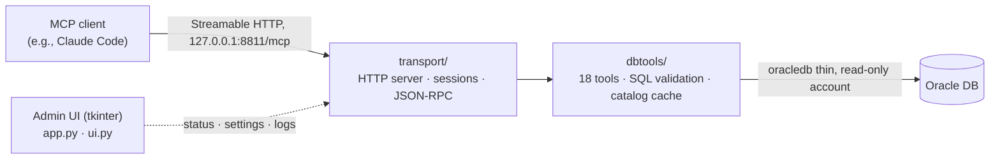

<!-- TODO: Add an admin UI screenshot or demo GIF under assets/ and insert it below the hero -->

<h1 align="center">DBridge</h1>

<p align="center">
  <b>English</b> · <a href="README.ko.md">한국어</a>
</p>

<p align="center">
  <strong>Read-only Oracle MCP proxy built for air-gapped networks</strong>
  <br/>
  <sub>AI agents such as Claude Code explore and query an Oracle database through a local proxy on the PC. The proxy listens only on <code>127.0.0.1</code>, and user SQL is limited to a single <code>SELECT</code> or <code>WITH</code> statement.</sub>
</p>

<p align="center">
  
  
  
  
  
  <a href="LICENSE"></a>
</p>

<p align="center">
  <a href="#why-dbridge">Why</a> ·
  <a href="#quick-start">Quick start</a> ·
  <a href="#air-gapped-deployment">Air-gapped deployment</a> ·
  <a href="#18-tools">Tools</a> ·
  <a href="#safeguards">Safeguards</a> ·
  <a href="#admin-ui">Admin UI</a> ·
  <a href="#configuration">Configuration</a> ·
  <a href="#development">Development</a> ·
  <a href="#security-and-limitations">Security</a> ·
  <a href="#contributing">Contributing</a>
</p>

Letting an AI agent query databases on an air-gapped network takes a connection point that runs locally with no external service, blocks writes, and never hands the password to the agent. DBridge is a resident MCP server built around those requirements. The proxy itself needs no internet access. The agent's LLM, however, is reached through the MCP client, so an offline network still needs an LLM endpoint reachable from inside it.

- **How it connects**: It runs in the background on your PC and serves an [MCP](https://modelcontextprotocol.io/) Streamable HTTP endpoint at `http://127.0.0.1:8811/mcp`. Registering it in Claude Code takes one URL. The code enforces `127.0.0.1` as the only allowed bind address.
- **Read-only**: SQL sent by the agent runs only as a single `SELECT` or `WITH` statement that has passed the proxy's SQL validation layer. Row counts and execution time are capped.
- **18 tools for the agent**: They return what the agent needs to know before writing SQL (schema summaries, keyword search, table structure, partitions, execution plans, column profiles, join candidates) in small responses. Even on databases with thousands of tables, they are designed to narrow down instead of listing everything.
- **Install**: The transport, tools, admin UI (tkinter), and tests use only the Python standard library. Only the actual Oracle connection needs `oracledb` (thin mode, no Oracle Client required). On Windows, you only need to transfer five wheels, dependencies included (about 6MB).
- **Operations**: The Windows admin UI shows server status, connection health, the Claude integration snippet, tool test runs, settings editing, and logs. It can be packaged and deployed as a single exe with PyInstaller.

> DBridge is used in production and is currently in beta. The tool set and configuration keys may change. The SQL validation layer does not replace database account privileges, so always connect with a read-only account.

<!-- TODO: State the Oracle Database version range verified in production (the thin-mode minimum is 12.1) -->

---

## Why DBridge

| Constraint on an air-gapped network | Common blocker | How DBridge handles it |
| :--- | :--- | :--- |
| No external SaaS | Cloud database connectors and hosted MCP servers cannot be used | A local process that runs only on the PC. The only outbound connection the proxy opens is the configured Oracle DSN (the LLM connection is the MCP client's responsibility) |
| Restricted pip installs | MCP servers and ORMs with many dependencies, or a separate CLI distribution, are hard to bring in | Mostly the standard library. The only packages to bring in are `oracledb` and its dependencies |
| Risk of an accidental write | A tool that runs SQL as-is will also run writes if the account is broadly privileged | An SQL validation layer that lets through only a single `SELECT` or `WITH`, only identifiers found in the catalog (`query`), a server-side row limit, and a query timeout. Designed to be used with a read-only account |
| Wasted tokens | Pulling entire table lists or result sets overflows the context | Tools are designed to show a count summary first, then narrow by keyword, owner, and limit. If the result is cut off, they report `truncated: true` |
| Exploring thousands of schemas | The agent guesses table names and throws SQL at them | Unified search over the catalog cache (table and column names and comments), synonym resolution, and join-candidate suggestions. The server passes an instruction, "do not guess; confirm with the tools," through MCP `instructions` |
| Password exposure | Connection details end up in the agent configuration or the conversation | The password stays only in the proxy config (`password_env` recommended). The agent sees only the connection name, DSN, and login account name, and no tool returns the password. Logs, errors, and status displays mask it as `***` |
| DBA approval | Approval is hard if an agent tool requires DBA privileges or a dictionary role | Works with only `CREATE SESSION` and `READ` on the target objects. Reads only `ALL_*` views, and does not use `DBA_*`, `V$`, or `DBMS_SQL`. Cancels execution on the server side on timeout |
| Access-control policy | It must not become a path that bypasses the organization's DB access-control environment | The proxy binds only to `127.0.0.1`. Optionally it starts only while a named program, such as a DB access-control agent, is running (`require_process`, a one-time process-name check at startup) |

---

## Quick start

**Windows: install the release build.** Download one of these from [Releases](https://github.com/SunnyJLab/DBridge/releases/latest). Python and Oracle Instant Client are bundled or unnecessary, so the target PC needs neither. For an air-gapped PC, carry the file in as-is.

| File | Use |
| :--- | :--- |
| `DBridge-<version>-win-x64-setup.exe` | Installer. Per-user install to `%LOCALAPPDATA%\Programs\DBridge` without administrator rights, with a Start menu entry and an uninstaller |
| `DBridge-<version>-win-x64-portable.zip` | Same build without an installer. Unzip into any writable folder and run `DBridge.exe` |

The first run creates `config.json` next to `DBridge.exe`. Fill in your connection there (format in step 2 below) or in the admin UI, then continue from step 4, Connect to Claude Code. Check downloads against `SHA256SUMS.txt` in the release. The binaries are not code-signed, so Windows SmartScreen may warn on first run.

The steps below run DBridge from source instead. To transfer and deploy the source to an air-gapped PC, see [Air-gapped deployment](#air-gapped-deployment).

Requirements

- Python 3.11 (the production baseline; a distribution that includes tkinter). Current `oracledb` requires Python 3.10 or later. <!-- TODO: Settle the supported version range. Unit tests are confirmed to pass on 3.13 as well -->
- An Oracle database to connect to (12.1 or later) and a **read-only account**. Thin mode cannot connect to a database that requires Native Network Encryption (NNE) (`DPY-3001`). In that case, discuss switching to a TLS connection with the DBA.
- The admin UI needs tkinter. The official Windows installer includes it by default. The embeddable zip distribution does not. Headless mode still works without tkinter.
- Claude Code, or another MCP client that supports Streamable HTTP

The target production environment is Windows x64. Development and testing also work on macOS and Linux.

**1. Virtual environment and dependencies**

Windows (PowerShell):

```powershell
git clone https://github.com/SunnyJLab/DBridge.git
cd DBridge
python -m venv .venv
.venv\Scripts\pip install -r requirements.txt
```

macOS / Linux:

```sh
git clone https://github.com/SunnyJLab/DBridge.git
cd DBridge
python3 -m venv .venv
.venv/bin/pip install -r requirements.txt
```

`oracledb` runs in thin mode, so you do not need to install Oracle Instant Client. `cryptography`, which thin mode uses, is installed along with `oracledb` as its dependency.

**2. Writing config.json**

Create `config.json` at the repo root (next to `app.py`). If the file is missing, the first run creates it with defaults. The first-run defaults do not include a startup gate. To use the gate, put a process name in `require_process`. `config.json` is listed in `.gitignore`, so it is not committed.

```json
{
  "proxy": { "host": "127.0.0.1", "port": 8811, "log_level": "INFO" },
  "connections": [
    {
      "name": "dw",
      "dsn": "db.example.internal:1521/ORCL",
      "user": "readonly_user",
      "password_env": "MCP_DB_PW",
      "pool_max": 5
    }
  ],
  "require_process": []
}
```

The password is read from the environment variable named in `password_env`.

```powershell
$env:MCP_DB_PW = "your-password"     # Windows (PowerShell, current window only)
[Environment]::SetEnvironmentVariable("MCP_DB_PW", "your-password", "User")   # Persist as a user environment variable
```

```sh
export MCP_DB_PW='your-password'     # macOS / Linux
```

If `"require_process": []`, or if you **omit** this key, the startup gate is off. There is no default process to watch. To use the gate, specify a process name. See [Startup gate](#4-startup-gate-require_process) for details.

A value set with `[Environment]::SetEnvironmentVariable` is visible only to windows opened afterward and to programs launched from File Explorer. Use this method if you start the admin UI or the exe from File Explorer.

**3. Run**

```sh
# Admin UI + MCP server (default: config.json next to app.py)
.venv/bin/python app.py                      # Windows: .venv\Scripts\python app.py
.venv/bin/python app.py --config path/to/config.json

# MCP server only, with no UI (headless)
.venv/bin/python -m transport --config config.json
```

The admin UI opens, and the server status appears at the bottom of the sidebar. Right after startup, the server collects each connection's catalog (metadata such as tables, columns, and comments) in the background. On a large database this can take tens of seconds, and the UI and the MCP endpoint still respond during that time. If a connection fails, that connection's row on the status page changes to `실패` (failed). If there is an ORA error code, it is shown as well. A cause with no code, such as a missing environment variable, is recorded on the **로그** (Logs) page.

Headless mode writes logs only to standard error, does not create a file under `logs/`, and does not create defaults when `config.json` is missing. Stop it with Ctrl+C.

**4. Connect to Claude Code**

From the CLI:

```sh
claude mcp add --transport http dbridge http://127.0.0.1:8811/mcp
```

Or `.mcp.json` at the project root:

```json
{
  "mcpServers": {
    "dbridge": {
      "type": "http",
      "url": "http://127.0.0.1:8811/mcp"
    }
  }
}
```

Both snippets are generated for the current port on the admin UI's **Claude 연동** (Claude integration) page, and can be copied with a button. The server name is `dbridge`, and the window title is DBridge. Clients can connect only while the proxy is running.

Other MCP clients can connect to the same address if they support the Streamable HTTP transport. The MCP protocol version the server supports is `2025-03-26`. <!-- TODO: Add a table of measured results for clients other than Claude Code (name, version, and whether it works) -->

Once connected, try prompts like these:

- "What schemas are on the dw connection? Just give me the counts"
- "Find tables related to 'sales' and tell me their column structure"
- "Show the row counts of the 3 most recent partitions of this table, then filter by the partition key and sum last month"

<details>
<summary><b>Troubleshooting the first run</b></summary>

| Symptom | Cause and what to do |
| :--- | :--- |
| A dialog saying "필수 프로그램이 실행 중이 아닙니다" ("Required program is not running"), and the app exits | The process named in `require_process` is not running. To turn the gate off, remove the key or set it to `[]` |
| `ModuleNotFoundError: No module named 'tkinter'` | This Python has no tkinter. Use a distribution that includes tkinter, or run headless (`python -m transport`) |
| The connection is `실패` (failed), and the connection test says "DB 드라이버를 사용할 수 없습니다" ("The DB driver is not available") | `oracledb` is not installed, or the `password_env` variable is not visible to this process. Check the cause on the **로그** (Logs) page |
| `DPY-3001` | The database requires Native Network Encryption. Thin mode does not support it |
| `DPY-3010` / `DPY-3015` | The database is Oracle 11.2 or earlier, or the account has only the 10G password verifier |
| The server comes up in the stopped state, and the log shows a port-in-use error | Change `proxy.port`, and also change the address registered in the MCP client |
| `FileNotFoundError` in headless mode | Headless mode does not create `config.json`. Create the file first |

</details>

---

## Air-gapped deployment

### 1. Offline wheel transfer

The transport, tools, and UI use only the standard library, so the only packages to bring in are `oracledb` and its dependencies. `oracledb` and `cryptography` are **wheels that contain native extensions**, so when you download them on an internet-connected PC you must specify the target PC's platform and Python version.

```powershell
# 1) Internet-connected PC: download the wheels with the target environment specified (example: Windows x64, Python 3.11)
python -m pip download oracledb -d wheels --only-binary=:all: --platform win_amd64 --python-version 3.11

# 2) After transferring the source folder and the wheels folder, on the air-gapped PC
python -m venv .venv
.venv\Scripts\pip install --no-index --find-links wheels -r requirements.txt
```

Files to transfer (measured on Windows x64, Python 3.11)

| File | Size | Notes |
| :--- | ---: | :--- |
| Source (`*.py`, `theme_sv/`) | about 0.9MB | `theme_sv/` is needed only when using the `sun` palette |
| `oracledb-*-cp311-win_amd64.whl` | about 2.1MB | Thin-mode driver |
| `cryptography-*-win_amd64.whl` | about 3.8MB | A dependency of `oracledb` |
| `cffi`, `pycparser`, `typing_extensions` | about 0.3MB | Dependencies |

- If the target PC's Python version differs from `--python-version`, pip cannot find matching wheels at install time. Before you transfer them, check the filenames in the `wheels` folder (`cp311`, `win_amd64`, and so on).
- Versions and sizes depend on when you download them. Current `oracledb` requires Python 3.10 or later.
- If the target PC has no Python, bring a Python installer along as well, or use the exe build below.
- Oracle Instant Client is not required (thin mode).
- Administrator rights are not required. It does not register any service or registry entries.

### 2. Building the exe (PyInstaller)

The [release](https://github.com/SunnyJLab/DBridge/releases) installer and portable zip are built by `.github/workflows/release-windows.yml` on a Windows x64 runner with Python 3.11. Pushing a `v<version>` tag that matches `SERVER_INFO` in `transport/dispatch.py` runs the unit tests, builds the exe, smoke-tests it, packages it, and publishes the release.

To build it yourself, use the same Windows x64 + Python 3.11 environment as the target (PyInstaller does not cross-build). If the build PC is inside the air-gapped network, bring in the `pyinstaller` wheel the same way as above.

```powershell
.venv\Scripts\pip install --no-index --find-links wheels pyinstaller
.venv\Scripts\pyinstaller --noconfirm --clean packaging\DBridge.spec
.venv\Scripts\python packaging\smoke_test.py dist\DBridge
# optional, with Inno Setup installed: dist\DBridge-<version>-win-x64-setup.exe
iscc /DAppVersion=0.3.0 packaging\DBridge.iss
```

- `packaging/DBridge.spec` makes a one-folder windowed build in `dist\DBridge\` (`DBridge.exe` plus `_internal\`). It bundles `theme_sv/` and lists the modules that `oracledb` imports from compiled code, including `cryptography`, which PyInstaller cannot see on its own.
- `packaging/smoke_test.py` starts the built exe against a closed port and checks MCP `initialize`, the tool count, and that the bundled thin driver was reached.
- `packaging/DBridge.iss` is the Inno Setup script for the installer.
- A windowed exe has no console, so startup failures are reported in a message box and in `logs/proxy.log`.
- `config.json` is not bundled into the exe. The exe reads `config.json` in the same folder, and creates defaults if it is missing. `logs/`, `relationships.d/`, and settings backups (`backup/`) also live in the folder next to the exe, so that folder must be writable.

The deliverable is the `dist\DBridge\` folder plus a `config.json` next to `DBridge.exe` (and, optionally, `relationships.d/`).

### 3. Network boundary

In short: the only connection the proxy accepts is `127.0.0.1` on the same PC, and the only outbound connection is the Oracle DSN written in `config.json`.

| Connection | Target | Purpose |
| :--- | :--- | :--- |
| Listen (HTTP) | `127.0.0.1:{proxy.port}` (default 8811), path `/mcp` only | Receive requests from the MCP client |
| Database connection (Oracle Net, thin) | `connections[].dsn` | Catalog collection, tool execution, and a periodic health check (`SELECT 1 FROM DUAL`, about every 10 seconds) |

- If `proxy.host` is set to anything other than `127.0.0.1`, config validation rejects it. There is no option to bind to `0.0.0.0` or an external IP.
- If the port is already in use, the admin UI keeps the window open, leaves the server in the stopped state, and writes the error to the log (headless exits with code 1). After you change `proxy.port`, you also have to change the address registered in the MCP client.
- There is no code that collects usage statistics, checks for updates, or calls an external CDN or web font. The admin UI is a native tkinter window, so it does not use a browser or a web server.
- Communication with the agent (the LLM) is handled by the MCP client (for example, Claude Code). **Database data returned as a tool result is passed through the MCP client to the LLM that client uses.** Where the LLM runs is decided by the client configuration, not by the proxy, so review your data-export rules against the client configuration.

### 4. Startup gate (`require_process`)

You can make the proxy start only while a named program, such as a DB access-control agent, is running. This keeps the proxy from being used on a path that bypasses the access-control environment.

```json
{ "require_process": ["access-control-agent.exe"] }
```

| Value | Behavior |
| :--- | :--- |
| Key omitted, or `[]` (empty array) | Gate off. No default process to watch |
| A string, or a non-empty array of strings | Every listed executable name must all be running for the proxy to start (case-insensitive) |


- The check happens **once, at startup** (both the admin UI and headless). If the named program exits while the proxy is running, the proxy is not stopped.
- On Windows it checks process names with `tasklist`. On macOS and Linux it uses `ps`. Because the check is by process name, it cannot distinguish a different program with the same name.
- If the condition is not met, the admin UI shows a message box, logs a one-line reason to `logs/proxy.log`, and exits. Headless mode prints to standard error and exits with code 1.

### 5. Summary for security review

| Item | Detail |
| :--- | :--- |
| Running process | One Python process (or one PyInstaller exe). At startup it runs `tasklist` (Windows) or `ps` once to check `require_process` |
| Listening port | One port, `127.0.0.1:{proxy.port}` (default 8811). No authentication. Only a local process on the same PC can reach it |
| Outbound connections | Only the Oracle database in `connections[].dsn` |
| What stays on disk | `config.json` (next to the exe or `app.py`), a backup at `backup/YYYYMMDDHHMMSS/config.json` when settings are saved, and a short-lived `config.json.tmp` while saving. The catalog cache stays in memory only |
| Logs | `logs/proxy.log` (5MB, 3 rotated backups, UTF-8). Records HTTP request lines, startup and shutdown, and connection and catalog warnings and errors. Does not record tool names, arguments, or SQL text (this is not an audit log; if you need auditing, turn on database auditing for the login account). Passwords are replaced with `***`. Headless mode has no file log |
| Secrets | `password_env` (an environment variable) is recommended. A plaintext `password` is also allowed, and a password entered in the admin UI form is stored in plaintext in `config.json`. There is no application-level encryption |
| Database write path | None by default. Only when `explain` is turned on: INSERT into the dedicated PLAN_TABLE you specify, then DELETE its own rows (see [Safeguards](#safeguards)) |
| OS features used | Windows: DPI awareness (`shcore`/`user32`), switching an input field to the English IME (`imm32`), and clipboard copy (tkinter) |
| Privileges | Administrator rights are not required. No service or auto-start registration. The installer only adds a per-user uninstall entry (HKCU) and a Start menu shortcut; the portable zip and source touch no registry |

**Updates and removal**

- There is no automatic update. For a new version, run the new installer over the old one, or replace the source (or the program folder). `config.json`, `logs/`, `backup/`, and `relationships.d/` are kept.
- To remove it, uninstall from Windows Settings (installer) or delete the program folder. Uninstall leaves `config.json`, `logs/`, `backup/`, and `relationships.d/` in place; delete the folder to remove them. Remove the entry registered in the MCP client separately, for example with `claude mcp remove dbridge`.

### 6. Summary for DBA review

**Privileges required**

| Purpose | Privilege | Notes |
| :--- | :--- | :--- |
| Connect | `CREATE SESSION` | |
| Objects to query | `READ` (recommended) or `SELECT` on the tables and views you need | `READ` blocks `SELECT ... FOR UPDATE` row locks at the database level. The proxy also rejects `FOR UPDATE`, but enforcing it at both layers is safer |
| Catalog | No extra privilege | Reads only `ALL_*` dictionary views. Only objects the login account can see (including public synonyms) are visible |
| `validate_sql` | No extra privilege | Parses on the server only. Does not use `DBMS_SQL` |
| `explain` (optional) | `INSERT`/`SELECT`/`DELETE` on a dedicated PLAN_TABLE, and execute `DBMS_XPLAN` | See [Safeguards](#the-only-write-path-explain) |

Privileges you do not need: the `DBA` role, `SELECT ANY TABLE`, `SELECT ANY DICTIONARY`, `SELECT_CATALOG_ROLE`, access to `V$` views, and any write privilege (except the dedicated table for `explain`).

```sql
-- Example (adjust the names for your environment)
CREATE USER mcp_ro IDENTIFIED BY "...";
GRANT CREATE SESSION TO mcp_ro;
GRANT READ ON dw.f_sales TO mcp_ro;   -- for each object you need
```

**Database load**

- At startup, each connection runs 13 `ALL_*` dictionary queries once, in order, and loads the catalog into memory. It does not filter by owner, so it reads every object the account can see. `proxy.query_timeout` applies to each query, so on a database with a very large dictionary you may need to raise the timeout.
- After collection finishes, each connection sends a `SELECT 1 FROM DUAL` health check every 10 seconds.
- The connection pool opens sessions one at a time when needed and keeps up to `pool_max` of them. Open sessions are not closed until the process exits, so set this together with `IDLE_TIME` and `SESSIONS_PER_USER` on the database profile.
- `count_rows` (`exact`/`where`), `table_profile` (`live`), and `query_summary` aggregate real tables, so a full scan can happen. The proxy limits only the call duration, not the number of blocks read. If you need that limit, constrain the login account with a database profile (`CPU_PER_CALL`, `LOGICAL_READS_PER_CALL`) or Resource Manager.

**How sessions appear in the database**

- The proxy does not set `MODULE`, `ACTION`, or `CLIENT_IDENTIFIER`. `V$SESSION` shows only the driver defaults (executable name, PC host name, and OS user).
- If several people share the same database account, the database cannot tell them apart. Issuing a separate account per user (per PC) is recommended.

<!-- TODO: Consider setting conn.module / conn.action (tool name) / conn.client_identifier when a session is acquired -->

---
## 18 tools

All tools are exposed through MCP `tools/list`, and each tool's description string is passed directly to the agent. The table below follows the registration order (exposure order) in `dbtools/tools/__init__.py`.

| Tool | One-line description |
| :--- | :--- |
| `list_connections` | Names and status of registered connections, plus cached schema and table counts. Also reports whether a common code table is registered |
| `my_scope` | Without `owner`, returns only the counts of tables, views, and partitioned tables per schema. With `owner`, returns the objects in that schema |
| `list_tables` | Lists tables and views by owner and name LIKE pattern, with statistics-based approximate row counts |
| `describe_table` | Column names, types, NULL status, defaults, comments, PKs, indexes, and partition keys. Uses the cache by default; set `live: true` for a live query |
| `search_catalog` | Searches table and column names and comments together by keyword (cached search). Searches all connections if `connection` is omitted |
| `catalog_refresh` | Recollects the catalog cache. Use when a newly created object returns `UNKNOWN_OBJECT` |
| `sample_rows` | Top N rows from a table (up to 20); you can specify only the columns you need |
| `count_rows` | Uses a statistics estimate by default. Runs an actual `COUNT(*)` if `where` is provided or `exact: true` |
| `query` | Runs a single `SELECT`/`WITH` with bind variables. Default 100 rows, maximum 1000 |
| `resolve_object` | Resolves a name, including synonym resolution, to `OWNER.TABLE` and confirms whether it is accessible |
| `validate_sql` | Validates syntax, objects, and privileges by parsing on the Oracle server, without execution |
| `explain` | Summarizes the execution plan (cost, estimated rows, access method, partition pruning, warnings) or returns raw `DBMS_XPLAN` output. Requires separate configuration |
| `partition_info` | Returns a table's partition type, keys, recent boundaries, and row counts, or schema-level missing ranges, empty partitions, and unanalyzed partitions |
| `table_profile` | Profiles columns. By default, reads optimizer statistics only and does not scan; `live` measures specified columns (up to 5) |
| `cross_query` | Runs the same SQL in parallel across multiple connections and merges the results with connection names |
| `query_summary` | Returns no result rows, only row count and per-column min/max/distinct/null summaries |
| `suggest_joins` | Suggests join candidates with source and confidence. Precedence: manual entries in `relationships.d` > FK constraints > column-name rules |
| `compare_schema` | Compares table and view structures across two connections and schemas (cache-based) |

### Recommended flow: explore → understand → validate → query

The server passes the following flow and the principle "Do not guess table names; confirm them with tools" to the agent through `instructions` in the MCP `initialize` response. The same order is effective when writing prompts yourself.

| Step | Purpose | Commonly used tools |
| :--- | :--- | :--- |
| 1. Explore | See counts of what is where, then narrow down the target | `list_connections` → `my_scope` (without owner) → `search_catalog` / `list_tables` (with a pattern) → `resolve_object` |
| 2. Understand | Learn the target table's structure, relationships, and data shape | `describe_table`, `suggest_joins`, `partition_info`, `table_profile`, `sample_rows`, `count_rows` |
| 3. Validate | Check heavyweight SQL before running it | `validate_sql`, `explain`, `query_summary` |
| 4. Query | Retrieve only what you need | `query`, `cross_query` |

- If a result contains `truncated: true`, do not list more. Narrow the request by keyword, owner, or conditions and call again.
- Errors return `code`, `message`, and `hint`. `hint` suggests the next tool to call (for example, if `NO_ACCESS`, recheck the scope with `my_scope`).
- Use `compare_schema` for structure comparisons and `cross_query` to run the same SQL across multiple databases.

<details>
<summary><b>Call example (<code>query</code>)</b></summary>

```json
{
  "name": "query",
  "arguments": {
    "connection": "dw",
    "sql": "SELECT PROD_CD, SUM(SALE_AMT) AS AMT FROM DW.F_SALES WHERE BASE_DT >= :from_dt GROUP BY PROD_CD",
    "binds": { "from_dt": "2026-08-01" },
    "max_rows": 50
  }
}
```

In `query`, pass values as `:name` binds instead of literals. If string or numeric literals are present, validation rejects the query and returns a `hint` to use binds.

</details>

<details>
<summary><b>Key tool limits</b></summary>

| Tool | Limit |
| :--- | :--- |
| `query`, `cross_query` | `max_rows` default 100, maximum 1000 |
| `sample_rows` | Maximum 20 rows |
| `list_tables` | `limit` default 100, maximum 500 |
| `search_catalog` | `limit` default 50, maximum 200 |
| `my_scope` | Maximum 200 objects when `owner` is specified |
| `table_profile` | Maximum 5 `live` columns, maximum `top_n` of 50 |
| `query_summary` | Maximum 100 summary columns. Aggregates the entire result, so it scans regardless of the row limit |
| LOB values | Truncated at 2000 characters and marked `(truncated)` |

These limits directly affect the agent's token budget, so they are not configurable. The single source of truth for the layered limits is `dbtools/catalog.py`.

</details>

---

## Safeguards

DBridge's safeguards are a **validation layer that reduces agent mistakes**. They do not replace database account privileges (a read-only account). Do not give the proxy's account write privileges on the tables it queries.

### SQL validation layer (`dbtools/sql_safety.py`)

All tools that accept SQL from the agent (`query`, `cross_query`, `query_summary`, `validate_sql`, `explain`) validate statement form before execution. They use a character scanner that understands Oracle comments (`--`, `/* */`) and literal syntax (`'...'`, `n'...'`, `q'[...]'`), rather than regular expressions. Ambiguous or unterminated input is rejected (fail-closed).

Blocked:

- Statements that do not start with `SELECT` or `WITH`, and multiple statements joined with semicolons
- DML, DDL, privilege, transaction, and PL/SQL keywords (`INSERT`, `UPDATE`, `DELETE`, `MERGE`, `CREATE`, `ALTER`, `DROP`, `TRUNCATE`, `GRANT`, `REVOKE`, `COMMIT`, `ROLLBACK`, `BEGIN`, `DECLARE`, `EXECUTE`, `CALL`, `LOCK`, `SET`, etc.)
- `SELECT ... INTO`, `FOR UPDATE`
- Database links (`@`)

`query` adds a catalog-based check on top of this:

- Referenced schemas, tables, and columns must exist in the catalog cache (otherwise `UNKNOWN_OBJECT`)
- Only functions on the read-only allowlist can be called
- Values must use bind variables (string and numeric literals are rejected)
- Constructs that are difficult to validate are rejected, including table functions, hierarchical queries (`CONNECT BY`), recursive CTEs, `SAMPLE`/partition clauses, and `GROUPING SETS`/`ROLLUP`/`CUBE`

The `where` clauses in `count_rows` and `table_profile` accept only a separate restricted syntax (comparisons, `AND`/`OR`/`NOT`, `IS NULL`, `IN`, `BETWEEN`, `LIKE`; values must be binds). Identifiers in SQL generated internally by tools pass through `validate_identifier`/`quote_identifier`; strings are not concatenated directly.

To be clear, SQL tools other than `query` (`cross_query`, `query_summary`, `validate_sql`, `explain`) validate statement form only and do not perform catalog-based validation. The validation layer does not guarantee that it can identify every case, such as side effects from functions not on the allowlist. Database account privileges remain the final line of defense.

### Row and time limits

- **Rows**: `query` wraps validated SQL in `SELECT * FROM (...) WHERE ROWNUM <= :n` to enforce the limit **on the database server**. If the limit is exceeded, the result includes `truncated: true`.
- **Timeout**: Each database call is capped by `proxy.query_timeout` (30 seconds by default). If it expires, the driver is asked to cancel execution on the server, the session is discarded from the pool, and `TIMEOUT` is returned. If one tool makes multiple database calls, total elapsed time can exceed this limit. Waiting for a connection from the pool has the same limit.
- **Cancellation**: MCP client request cancellation (`notifications/cancelled`) is not yet handled. Even if the client cancels, the database query runs until it times out.
- **Connections**: Each connection's pool is limited by `pool_max` (5 by default).
- **HTTP**: Request bodies are limited to 1 MB, and JSON-RPC batches to 64 requests. Sessions are cleaned up after 30 minutes without a request.

### The only write path: `explain`

Oracle `EXPLAIN PLAN` is not a read operation; it inserts rows into PLAN_TABLE. Therefore, `explain` is disabled by default. To enable it, specify a dedicated PLAN_TABLE in the configuration.

```json
{ "explain": { "enabled": true, "plan_table": "MCP_PLAN.PLAN_TABLE" } }
```

- The only target is the table specified by `explain.plan_table`. The tool inserts only its own `STATEMENT_ID` row, then deletes it and commits at the end.
- The account needs INSERT/SELECT/DELETE privileges on that dedicated table and permission to execute `DBMS_XPLAN`. Keep this table separate from the grants on the queried tables, ideally in a schema the connection account does not own.

### Secret masking

- Passwords are accepted through `password_env` (an environment variable name) or `password` and passed directly to the driver. The application does not encrypt or decrypt them.
- Configuration passed to the tool layer has the `password`/`password_env` keys removed. Agents receive the connection name, DSN (`host:port/service`), and account name, but not the password.
- Password strings are replaced with `***` if they appear in driver exceptions, logs, or admin UI status displays.
- The catalog reads only `ALL_*` dictionary views and does not query `DBA_*` views. The agent sees the same scope as the connected account.

---

## Admin UI

This is a tkinter desktop window launched with `python app.py`. The UI text is currently Korean only. It has six pages in the left sidebar, with server status and version shown at the bottom. All database and socket operations run on worker threads so the UI remains responsive.

<details>
<summary><b>Features by page</b></summary>

| Page | Features |
| :--- | :--- |
| 상태 (Status) | Server status, uptime, and request count; per-connection status, latency, and pool usage (shows the reason on failure); test a selected connection; start/stop the server |
| Claude 연동 (Claude integration) | `claude mcp add` command for the current port and an `.mcp.json` snippet, with copy buttons |
| 도구 (Tools) | List of 18 tools with descriptions, parameters, and examples. Run a test immediately with JSON arguments and inspect the result and elapsed time |
| 공통코드 (Common code) | Register, inspect, and unregister the common code table (`common_code`) used to resolve code values. Automatically completes table names per connection |
| 설정 (Configuration) | Edit with a form (port, log level, add/remove/edit connections) or raw JSON. Saving performs validation → backup → atomic replace → server restart. Keys not handled by the form are preserved |
| 로그 (Logs) | Dark console, level filter (ALL/DEBUG/INFO/WARNING/ERROR), pause, clear, auto-scroll. Retains the most recent 5,000 lines |

- When saving settings, the existing file is copied to `backup/YYYYMMDDHHMMSS/config.json`, then written to a temporary file and replaced with `os.replace`. If validation fails, the original is unchanged.
- Values entered in the password field of the settings form are stored as plaintext `password` in `config.json`. To avoid plaintext storage, use `password_env` in the JSON editor.
- Choose a palette with `ui.palette` in `config.json`: `slate` (default), `nord`, `github`, `mono`, `sun`. `sun` uses the bundled Sun Valley ttk theme (`theme_sv/`). An invalid name produces a warning and the app starts with `slate`.
- On Windows, DPI awareness is enabled and fonts are selected in this order: `Segoe UI`/`Malgun Gothic`, then `Cascadia Mono`/`Consolas`. Other operating systems use available fallback fonts.

</details>

---

## Configuration

Configuration is stored in a single `config.json` file. The admin UI reads the file next to `app.py` (or the exe); headless mode reads the file specified with `--config`. It must be UTF-8 JSON (BOM is allowed).

```json
{
  "proxy": {
    "host": "127.0.0.1",
    "port": 8811,
    "log_level": "INFO",
    "query_timeout": 30
  },
  "connections": [
    {
      "name": "dw",
      "dsn": "db.example.internal:1521/ORCL",
      "user": "readonly_user",
      "password_env": "MCP_DW_PW",
      "pool_max": 5
    },
    {
      "name": "src",
      "dsn": "db2.example.internal:1521/SRCDB",
      "user": "readonly_user",
      "password_env": "MCP_SRC_PW",
      "pool_max": 3
    }
  ],
  "common_code": { "table": "COMMON.CODE_TABLES", "connection": "dw" },
  "tools": {
    "cross_query_workers": 4,
    "stale_change_ratio": 0.10,
    "high_rows_threshold": 1000000
  },
  "explain": { "enabled": true, "plan_table": "MCP_PLAN.PLAN_TABLE" },
  "ui": { "palette": "slate" },
  "require_process": []
}
```

| Key | Default | Description |
| :--- | :--- | :--- |
| `proxy.host` | `127.0.0.1` | Only `127.0.0.1` is allowed. Other values are rejected |
| `proxy.port` | `8811` | MCP endpoint port |
| `proxy.log_level` | `INFO` | `DEBUG` / `INFO` / `WARNING` / `ERROR` |
| `proxy.query_timeout` | `30` | Database call timeout (seconds, positive) |
| `connections[]` | (required) | At least one. The first connection's `driver` determines the driver for all connections |
| `connections[].name` | (required) | Connection name passed by the agent to tools. Must be unique |
| `connections[].dsn` | (required) | Oracle connection string (`host:port/service`) |
| `connections[].user` | (required) | Connection account. A read-only account is recommended |
| `connections[].password_env` | | Name of the environment variable containing the password. One of this or `password` is required |
| `connections[].password` | | Plaintext password. Use `password_env` if possible |
| `connections[].pool_max` | `5` | Maximum connection pool size (at least 1). Required in the admin UI path |
| `connections[].driver` | `oracle` | Currently only `oracle` is supported |
| `common_code` | (none) | Location of the common code table. `table` (`OWNER.TABLE`) and optional `connection`. `list_connections` reports it to the agent |
| `tools.cross_query_workers` | `4` | Number of concurrent `cross_query` workers (1–32). Lower it if `pool_max` is small |
| `tools.stale_change_ratio` | `0.10` | Change ratio at which `table_profile` considers statistics stale ((0, 1]) |
| `tools.high_rows_threshold` | `1000000` | Row-count threshold for the `HIGH_ROWS` warning in `explain` |
| `explain.enabled` / `explain.plan_table` | (disabled) | Enables the `explain` tool and specifies its dedicated PLAN_TABLE (see [Safeguards](#the-only-write-path-explain)) |
| `ui.palette` | `slate` | Admin UI color scheme. An invalid name triggers a warning and falls back to `slate` |
| `require_process` | (none) | Startup gate. Inactive if omitted or set to `[]`. Specify process names to enable it (see [Startup gate](#4-startup-gate-require_process)) |

- Unknown keys in the `tools` block and out-of-range values are rejected on save and startup.
- When settings change, the admin UI creates a new server and restarts it (no partial reset). The catalog is also recollected.

<details>
<summary><b>relationships.d: Manually registering join relationships</b></summary>

In a DW without FK constraints, `suggest_joins` estimates candidates using column-name rules only. Register known relationships as JSON files in the `relationships.d/` folder next to `app.py` (or the exe) to suggest them at the highest priority (`source: manual`, `confidence: 1.0`).

```json
{
  "connection": "dw",
  "table": "DW.F_SALES",
  "joins": [
    { "table": "DW.D_PROD", "on": [["PROD_CD", "PROD_CD"]], "direction": "parent" },
    { "table": "DW.D_CUST", "on": [["CUST_ID", "CUST_ID"]], "direction": "parent" }
  ]
}
```

- Files are read, never executed. A malformed file is skipped on its own and an error is logged; the remaining files load normally.
- Paths pointing outside the folder and symbolic links are rejected. Each file is limited to 1 MB.
- Files are reloaded at startup and on the restart after a settings save.

Adding new tools using only JSON, without code changes (`tools.d`), is not supported. Tools can only be added in code (see [Development](#development)).

</details>

---

## Development

### Tests

Unit tests run without a real Oracle database. A test double (`FakeDatabase`) replaces the database.

```sh
python -m unittest tests.test_http_transport tests.test_app_wiring \
  tests.test_dbtools_service tests.test_dbtools_foundation \
  tests.test_tool_modules tests.test_common_helpers \
  tests.test_process_guard tests.test_tool_optimization
```

- You can also run the full suite with `python -m unittest discover -s tests`. Tests that require a real Oracle database (`tests/test_real_*.py`) are skipped if the driver or database is unavailable.
- Scenarios that launch a real Tk window (`tests/_real_tk_*.py`) run in isolated subprocesses and are skipped if no display is available. This is because macOS Tk crashes when a root window is recreated in the same process.
- The unit tests above pass even if `oracledb` is not installed.

<!-- TODO: Add badges and usage instructions after configuring CI (e.g., GitHub Actions) -->

### Adding a tool

1. Create `dbtools/tools/<tool_name>.py`. Put the handler function and `definition()` (a `ToolDefinition` containing the name, description, parameters, examples, and handler) in one file. Define what the tool means in `description` only. This string is passed directly to agents through `tools/list`.
2. Register the import and add the module to the `_TOOL_MODULES` tuple in `dbtools/tools/__init__.py`. Registration order is the exposure order.
3. Update the test constants that validate the number of tools (`tests/test_tool_modules.py`, `tests/test_dbtools_service.py`).
4. Add a behavior test using `FakeDatabase` or a stub, without a real database.

Principles to follow:

- Do not assemble SQL strings. Pass user SQL through `validate_select_sql` (or `authorize_select_sql`) and identifiers through `validate_identifier`/`quote_identifier`. Raise errors in the `ToolError` family.
- Put logic used by two or more tools in `dbtools/common/`. Common modules do not import tools.
- Import row-limit constants from `dbtools/catalog.py`. Move policy values that vary by site into the `tools` block of `config.json`.
- Do not add external dependencies. Each one makes air-gapped transfer harder, so keep the transport, tools, and UI on the standard library.

<!-- TODO: Summarize this section and replace it with a link when CONTRIBUTING.md is written -->

### Architecture



| Path | Role |
| :--- | :--- |
| `app.py` | Admin UI entry point. Load settings → check startup conditions → logging → start server → UI |
| `ui.py` | Admin UI (status, Claude integration, tools, common code, settings, logs) |
| `config_store.py` | Load, validate, back up, and atomically save `config.json`; restart |
| `transport/` | Streamable HTTP MCP server (`server`), sessions (`session`), JSON-RPC dispatch (`dispatch`), settings validation (`config`), startup gate (`process_guard`). Standard library only. Run headless with `python -m transport` |
| `dbtools/tools/` | One file per tool |
| `dbtools/common/` | Input validation (`params`), result and error conversion (`results`), catalog access (`catalog_access`), and SQL execution (`execution`) shared by multiple tools |
| `dbtools/sql_safety.py` | SQL validation layer and identifier handling |
| `dbtools/catalog.py` | Per-connection catalog cache (`ALL_*` views only) |
| `dbtools/database.py` | `oracledb` thin adapter (pool, timeout, row limit, value normalization). Imports the driver only on first use |
| `dbtools/extensions.py` | `relationships.d` JSON loader |
| `theme_sv/` | Third-party Sun Valley ttk theme (MIT) |
| `tests/` | unittest. Runs without a real Oracle database |

---

## Security and limitations

DBridge is a **tool that lets agents read from a database**. Understand the following before using it.

**The validation layer does not replace privileges.** SQL validation aims to prevent agent errors and common write attempts; it does not guarantee that every bypass is blocked. Use a read-only account and grant SELECT privileges only on the required schemas. When enabling `explain`, grant no write privileges other than those needed for the dedicated PLAN_TABLE.

**The local endpoint has no authentication.** It binds only to `127.0.0.1`, so other PCs cannot access it, but any program running on the same PC can send requests to `/mcp` and call tools. Do not run it on shared machines (remote desktop hosts, shared PCs). <!-- TODO: Consider adding local token authentication or Origin validation -->

**Query results are passed to an LLM.** Rows and metadata returned by tools pass through the MCP client to the model used by that client. The surest way to protect schemas containing personal or sensitive data is to exclude them from the connection account's privileges. The proxy has no column-level masking.

**Passwords are not encrypted.** With `password_env`, only the environment variable name remains in `config.json`, but its value is still plaintext in the OS environment. If you use `password` or enter a password in the admin UI form, it remains plaintext in `config.json` and its backups (`backup/`).

**The proxy does not keep audit records.** Logs do not contain tool names, arguments, or SQL, and the proxy does not set `MODULE`/`CLIENT_IDENTIFIER` in database sessions. If you need to track who queried what, issue a separate DB account to each user (PC) and use database-side auditing.

**The startup gate checks only at launch.** `require_process` checks process names only. If a specified program exits after startup, the proxy continues running. This does not replace access control.

**Known limitations**

- Oracle is the only supported database. A driver dispatch point exists (`build_database` in `transport/config.py`), but there are no adapters for other DBMSs.
- Only thin mode is supported. Connections are not possible to Oracle 11.2 or earlier, databases requiring NNE or checksumming, or accounts with only a 10G password verifier. There is no option to switch to thick mode.
- Only MCP protocol version `2025-03-26` is supported. If a client requests another version, the server responds with this version.
- The catalog is collected once at startup and kept only in memory. New objects remain unavailable until `catalog_refresh` is called, and the catalog is recollected after restart. Collection can take time in databases with many objects, and fails for a connection if a dictionary query exceeds `proxy.query_timeout` or returns more than 1 million rows.
- Because of catalog-based validation, `query` rejects some otherwise valid SQL, including literals, functions outside the allowlist, and hierarchical queries. Agents can use the error `hint` to retry with binds or another tool.
- The admin UI and exe distribution target Windows x64. The app and tests also run on macOS and Linux, but they have not been validated as production environments.

<!-- TODO: Link after writing SECURITY.md (vulnerability reporting instructions) -->

---

## Contributing

Issues and PRs are welcome. Bug reports should include the Oracle version, MCP client, reproduction steps, and error `code`. Remove DSNs, account names, and schema names from logs and settings before attaching them. Before submitting a PR, confirm that the unit tests in [Development](#development) pass.

<!-- TODO: Link after writing CONTRIBUTING.md -->

---

## Disclaimer

DBridge connects to the actual database using the account configured by the user and runs queries requested by an AI agent. You are responsible for how retrieved data is handled and for the consequences.

- This software is provided as-is, and there is no guarantee that the SQL validation layer blocks every write or resource-heavy query.
- Before connecting to an organization's database, check its security, data export, and automation policies and approval procedures.
- You are responsible for complying with the data-handling policies of the MCP client and LLM that receive query results.
- This project is not affiliated with or endorsed by Oracle, Anthropic, or any other companies mentioned.

---

## License

MIT. See [LICENSE](LICENSE).

The Sun Valley ttk theme included in `theme_sv/` is licensed under the MIT license by rdbende. The original copyright notice and full license text ([theme_sv/LICENSE](theme_sv/LICENSE)) are retained unchanged.

---

<p align="center">
  <em>Read-only Oracle MCP proxy built for air-gapped networks</em>
  <br/>
  <sub>On your PC. Read-only. Only what you need.</sub>
</p>
